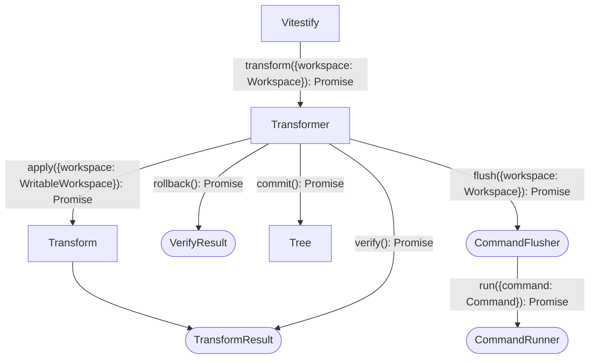
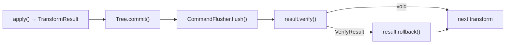
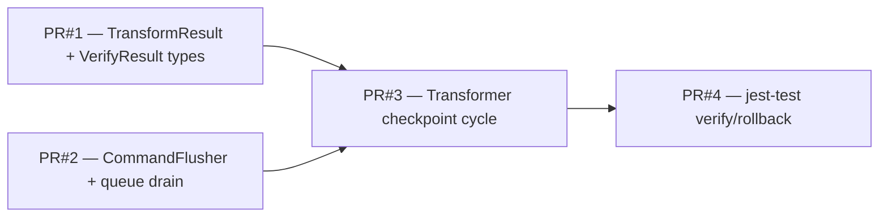

# Goals

- Developers running vitestify on their own repo should be able to migrate most tests to Vitest without the whole run failing because one file cannot be converted.
- When a test file cannot survive migration, it should stay runnable under Jest — vitestify migrates what it can and keeps the rest on Jest.
- Per-transform (or transform group) verification gives confidence that changes actually work (e.g. Vitest config loads, converted tests pass) before treating a step as successful.
- When verification fails, a transform-defined rollback should undo only the broken changes — not the entire migration.

# Non-Goals

- Requiring verification on every transform — only transforms that opt in define a verify step.
- Global or workspace-wide rollback — each transform rolls back only its own changes on verification failure.
- Git-based undo (reset, revert, stash) — rollback stays within vitestify's in-memory `Tree` / transform logic.
- Auto-retry or self-healing — a failed verification does not re-run or patch the transform automatically.
- Interactive prompts — no mid-run user input to choose what to rollback.
- Dry-run verification — verification runs after apply, not as a separate preview-without-changes mode.
- Report-only mode — verification failure always triggers rollback; no verify-without-rollback path.

# Desired Behavior

## Per-transform pipeline (default)

- [x] Transform without verification: `apply()` stages changes in `Tree` and returns void (`return;`); no commit, no commands, no verify yet.
- [x] Pipeline continues to the next transform with staged changes still in memory.

## Verifying transform (opt-in)

When `apply()` returns a `TransformResult`, `Transformer` runs a full checkpoint cycle before moving on:

- [x] `Transformer` calls `CommandFlusher` directly to run queued workspace commands (e.g. `pnpm install`) so verification can use real on-disk state.
- [x] Transforms without verification return void from `apply()`; transforms that opt in return `{ verify }`.
- [x] `TransformResult.verify()` runs (e.g. jest-test transform runs converted tests).
- [x] On verify success: `verify()` returns void (`return;`); pipeline continues to the next transform.
- [x] On verify failure: `verify()` returns `{ rollback }`; `Transformer` calls `rollback()` to undo only that transform's broken changes, then pipeline continues.

## End of run

- [x] After the last transform, any remaining staged changes are committed once (if not already flushed by a verifying transform).

## Examples

### jest-test transform group

- [x] After commit + `CommandFlusher`, verify runs Vitest against converted spec files.
- [x] On failure for individual files, rollback reverts only those files and renames them to `.jest.*` so Jest can still run them.
- [x] Passing files stay migrated; migration continues with a mix of Vitest and Jest tests.

# Design

`apply()` returns `void` or a `TransformResult`.
Transforms that opt into verification return `{ verify }` from `apply()`; `verify` is required on `TransformResult`.
`verify()` returns `void` or a `VerifyResult`; `rollback` is required on `VerifyResult`.
`Transformer` orchestrates the checkpoint cycle when `apply()` returns a `TransformResult`.
Rename `Finalizer` → `CommandFlusher`; `Transformer` calls it directly after `Tree.commit()`.

```typescript
interface Transform {
  apply(
    workspace: WritableWorkspace,
    options?: { onProgress?(detail: string): void },
  ): Promise<void | TransformResult>;
}

interface TransformResult {
  verify(): Promise<void | VerifyResult>;
}

interface VerifyResult {
  rollback(): Promise<void>;
}
```

- `apply()` returns void (`return;`) — no verification; staged changes stay in `Tree`; no checkpoint.
- `apply()` returns `{ verify }` — `Transformer` runs commit + flush + `verify()` after `apply()`.
- `verify()` returns void (`return;`) — verification passed.
- `verify()` returns `{ rollback }` — verification failed; `Transformer` calls `rollback()`.

## Diagram



### Checkpoint cycle (verifying transform)



# PR Plan



# ✅ PR#1 — Add TransformResult, VerifyResult; change Transform.apply() to return Promise\<void \| TransformResult\>

## Tasks

- [x] Change `Transform.apply()` return type to `Promise<void | TransformResult>`.
- [x] Add `TransformResult` with required `verify(): Promise<void | VerifyResult>`.
- [x] Add `VerifyResult` with required `rollback(): Promise<void>`.
- [x] Transforms without verification return void from `apply()` (`return;`).
- [x] Transforms that opt in return `{ verify }` from `apply()`.
- [x] `verify()` returns void on success (`return;`); returns `{ rollback }` on failure.
- [x] Transform groups (`defineTransformGroup`) compose child `apply()` calls; only the group wrapper returns `{ verify }` if the group opts in.

## Testing Strategy

_None — pure type/factory addition, exercised indirectly by PR#3's Transformer tests._

# ✅ PR#2 — Rename Finalizer → CommandFlusher; add CommandQueue.drain(); wire into Transformer constructor

## Tasks

- [x] Rename `Finalizer` → `CommandFlusher`; move from end-of-pipeline-only to injected dependency on `Transformer`.
- [x] Add `CommandQueue.drain(): Command[]` (or equivalent) so `CommandFlusher.flush()` runs only commands queued since the last flush.

## Testing Strategy

### ✅ Drains queued commands on flush

- Arrange workspace with 2 queued commands.
- Run `commandFlusher.flush(workspace)`.
- Assert both commands executed via `CommandRunner`.
- Assert command queue is empty after flush.

### ✅ Continues after command failure

- Arrange workspace with 2 commands; first fails, second succeeds.
- Run `commandFlusher.flush(workspace)`.
- Assert both commands were attempted; second still runs.

# ✅ PR#3 — Implement checkpoint cycle in Transformer; remove end-of-pipeline finalize from Vitestify

## Tasks

- [x] `Transformer` runs checkpoint cycle when `apply()` returns a `TransformResult`.
- [x] For verifying transforms: after `apply()`, call `tree.commit()`, then `commandFlusher.flush(workspace)`, then `result.verify()`, then `verifyResult.rollback()` when `verify()` returns a `VerifyResult`.
- [x] For non-verifying transforms: `apply()` returns void; staged changes stay in `Tree` until the next checkpoint or end-of-run commit.
- [x] Remove `Vitestify`'s end-of-pipeline `finalizer.finalize()` — command flushing is owned by `Transformer` checkpoints and a final flush at end of run.
- [x] End of run: `tree.commit()` for any remaining staged changes, then `commandFlusher.flush()` for any remaining queued commands.
- [x] `rollback()` runs after disk is up to date — it may stage reversions via `Tree` and call `tree.commit()` again.

## Testing Strategy

### ✅ Non-verifying transform does not flush before the next transform runs

- Arrange transform A (no `verify`) that stages a change to file A.
- Arrange transform B (no `verify`), inlined in the test: its `apply()` reads file A from the filesystem and stores the result in a variable before staging its own change.
- Run `Transformer.transform(workspace)`.
- Assert the variable is `null` — B's `apply()` ran before any commit/flush occurred, so file A wasn't yet on disk to read.

### ✅ Non-verifying transform's change is batched with the next checkpoint, not flushed early

- Arrange transform A (no `verify`) that stages a change to file A, followed by transform B (`verify`) that stages a change to file B.
- B's `verify()` reads both file A and file B from the filesystem.
- Run `Transformer.transform(workspace)`.
- Assert `verify()` observes both file A and file B already on disk with their migrated content — A's staged change was carried forward and flushed together with B's checkpoint, rather than being flushed separately right after A ran.

### ✅ Transform with verify succeeds when file is on disk

- Arrange a fake transform whose `apply()` stages a file change and returns `{ verify }`.
- `verify()` reads the file from the filesystem and returns void if the expected content is there, otherwise `{ rollback }`.
- Run `Transformer.transform(workspace)`.
- Assert the file is present on the real filesystem with the migrated content (proves commit + flush ran before `verify()`).
- Assert the file still has the migrated content after the run (no rollback triggered).

### ✅ Transform with verify rolls back by renaming the file on disk

- Arrange a fake transform whose `apply()` stages a file change and returns `{ verify }`.
- `verify()` reads the file from the filesystem, determines it failed, and returns `{ rollback }` where `rollback()` renames the file on disk (e.g. `.spec.ts` → `.jest.ts`) and restores the original content.
- Run `Transformer.transform(workspace)`.
- Assert the file no longer exists at its migrated path.
- Assert the renamed file exists on disk with the original (pre-migration) content.

### ✅ Pipeline continues to the next transform after a rollback

- Arrange transform A whose `apply()` stages a file change and returns `{ verify }`; `verify()` fails and returns `{ rollback }`.
- Arrange transform B (no `verify`), inlined in the test: its `apply()` sets a variable to `true` and stages a change to file B.
- Run `Transformer.transform(workspace)`.
- Assert the variable is `true` — B's `apply()` still ran after A's rollback, and file B ends up on disk with migrated content once the run finishes.

# ✅ PR#4 — jest-test apply() returns TransformResult with verify; implement Vitest run and per-file rollback

## Tasks

- [x] jest-test `apply()` returns `{ verify }` closing over transformed files and their original content.
- [x] jest-test `verify()` runs Vitest via `CommandRunner`; on success returns void; on failure returns `{ rollback }`.

## Testing Strategy

### ✅ Verify returns VerifyResult with rollback on failure

- Arrange workspace with 2 converted spec files; fake Vitest output reports 1 failure.
- Run `apply()`, then `result.verify()` on returned `TransformResult`.
- Assert `verify()` returns `{ rollback }`.

### ✅ Rollback reverts only failed files

- Arrange `VerifyResult` from jest-test verify with one failing file renamed `.jest.cts` → `.spec.ts`.
- Call `result.rollback()`.
- Assert failed file is renamed back to `.jest.cts` with original Jest content restored.
- Assert passing file remains `.spec.ts` with Vitest content.

# Alternatives Considered

- **Git-based rollback** (`git stash`/`reset`/`revert`) — rejected; couples vitestify to the target repo's git state (dirty tree, detached HEAD, no git at all) and can't scope to a single transform's changes without extra bookkeeping.
- **Whole-`Tree` snapshot/restore per transform** — rejected; reverting the whole `Tree` on failure would also discard other transforms' already-staged changes batched into the same checkpoint, not just the failing transform's.
- **Unconditional `rollback()` on every transform** (defined upfront on `Transform`/`TransformResult` regardless of outcome) — rejected in favor of `VerifyResult.rollback()`, returned only when verification fails; non-verifying transforms return void from `apply()` and successful `verify()` returns void, so rollback plumbing is only present when needed.
- **Global rollback of the entire migration on any verify failure** — rejected; defeats the goal of best-effort migration where passing files stay migrated and only failing ones fall back to Jest.
- **Auto-retry the transform on verify failure** — rejected; could mask flaky failures or loop without making progress, and hides the failure from the user instead of surfacing a mixed Vitest/Jest result.
- **Keep `Finalizer` end-of-pipeline-only, add a separate verify-only pass after** — rejected; would need duplicate command-running/commit logic to get real on-disk state mid-pipeline, instead of `Transformer` calling `CommandFlusher` directly as part of the checkpoint cycle.

# Future Work

## vitest-config transform verification

- After commit + `CommandFlusher`, verify runs Vitest in a lightweight mode (config loads, no test execution).
- On failure, rollback reverts vitest config / setup file changes staged by that transform.

# Kitchen Sink

<!-- Section 9 — to be filled -->
