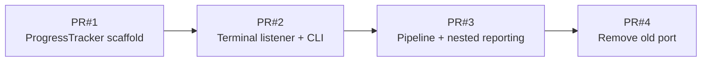

# Goals

- Nested transform groups (e.g. `jest-test` with 10 child transforms per file) bury per-file progress in ephemeral spinner sub-steps.
- Maintainers cannot easily answer "which files were transformed, by which child transform, and with what outcome?" after or during a run.
- Make nested transform progress first-class: track child transforms and affected files as structured state, not only as formatted spinner lines.

# Non-Goals

- CI-specific progress output (GitHub Actions annotations, etc.) — defer; design should allow future reporter sinks, but no CI reporter in this work.
- Persisting progress to disk — in-run state only; no snapshot file or progress log written after the run.
- Replacing or subsumming `DEBUG=vitestify:*` — debug logging stays a separate diagnostic channel.
- Changing enricher scan behavior or merging scan passes — progress refactor only.
- Per-file terminal detail for every transform — terminal reporter may still summarize; full per-file detail lives in progress state, not necessarily on screen.

# Desired Behavior

## Progress state (authoritative)

- [ ] A `ProgressTracker` holds the full run state: phases → typed steps, with status (`started` | `done` | `failed`).
- [ ] Pipeline stages (`Scanner`, `Analyzer`, `Transformer`) mutate progress state — they do not write to the terminal directly.
- [ ] Progress state includes an **analyze** phase with one `heuristic` step per heuristic.
- [ ] Progress state includes a **transform** phase with top-level `transform` steps (e.g. `jest-test`, `vitest-config`).
- [ ] Every phase snapshot exposes its expected step count (`enricherCount`, `heuristicsCount`, or `transformCount`) and a `steps` array. Step position is derived from the step's index in that array — not stored on each step.
- [ ] Transform groups (e.g. `jest-test`) record **child** `transform` **steps** nested under the parent transform step.
- [ ] Child transforms can update the number of transformed files.
- [ ] Progress state exposes roll-up counts (e.g. files transformed per child transform, per parent transform).
- [ ] Observers can read the current snapshot at any time (`snapshot()` / `snapshot$.value`) and subscribe to changes during the run (`snapshot$`).
- [ ] When stdout is not a TTY, progress state is still collected; only terminal output is suppressed.

## Terminal reporting (one sink)

- [ ] A `TerminalProgressReporter` receives snapshot updates via `notify(snapshot)`; a `TerminalProgressEngine` (used only by the reporter) diffs consecutive snapshots into instructions, and the reporter executes them via `@clack/prompts` — same general UX as today.
- [ ] Terminal shows phase intro/outro, numbered steps, spinners, and sub-step lines for live feedback.
- [ ] Terminal may summarize nested transform detail (top-level spinner + sub-steps) rather than listing every file on screen.
- [ ] Throttling applies at the reporting layer via `throttleProgressSnapshot(duration)` on `snapshot$` — only file-count changes (`detectedFileCount`, `transformedFileCount`) are throttled; status, activity messages, and other snapshot fields pass through immediately.

## Nested `jest-test` transform group (primary motivating scenario)

- [ ] While `jest-test` runs, progress state records each child transform as a nested `transform` step under `jest-test`.
- [ ] Each child transform updates `transformedFileCount` on its `TransformStepSnapshot`.
- [ ] After the run, state answers: how many files were transformed by each child transform.

## Unchanged user-visible CLI flow

- [ ] `vitestify` on a TTY still shows scan → analyze → transform → finalize progression with spinners.
- [ ] Scan enrichers report `filesDetected` count; non-scan work (e.g. nx graph loading) uses nested `activity` steps — not free-form strings on the enricher.
- [ ] Transform verify/rollback and apply-changes substeps still appear in terminal output.
- [ ] Non-TTY runs stay silent on the terminal (same as today).

# Design

Split progress into two layers:

1. `ProgressTracker` — core domain service: authoritative in-memory state + mutation API. Pipeline code writes here only. Lives in `core/models/progress-tracker`; aggregate snapshot types in `core/models/progress-tracker/progress-snapshot.ts`.
2. `ProgressReporter` — port in `core/ports/progress-reporter.ts`: receives snapshot updates via `notify(snapshot)` and renders to a sink (terminal today; logs/CI later). Wiring to `ProgressTracker` happens at the composition root (CLI), not inside the reporter.

The existing legacy `LegacyPhase` / `LegacyStep` handle pattern (on `LegacyProgressReporter`) stays during migration, but new pipeline code uses **typed phase and step factories** on `ProgressTracker` — thin facades over tracker nodes that update state and emit change events; they do not render.

`LegacyProgressReporterFake` is replaced by `ProgressTracker` (state + snapshot API). `LegacyTerminalProgressReporter` becomes a `TerminalProgressReporter` that receives snapshots via `notify(snapshot)` and drives `@clack/prompts` via a **`TerminalProgressEngine`** — a pure diff/format module that compares the previous and new snapshot and returns terminal instructions (intro, outro, spinner start/update/stop/error). Only the reporter uses the engine; nothing else in the codebase depends on it.

## Data model

Snapshot types live alongside their phase/step nodes in `core/models/progress-tracker/`. Snapshots use **discriminated unions** at both phase and step levels. Each type carries only fields relevant to that kind of work.

```typescript
type ProgressStatus = 'started' | 'done' | 'failed';

interface SnapshotBase {
  readonly status: ProgressStatus;
  readonly statusMessage?: string;
}

interface ProgressSnapshot {
  readonly phases: readonly PhaseSnapshot[];
}

type PhaseSnapshot =
  | ScanningPhaseSnapshot
  | AnalysisPhaseSnapshot
  | TransformingPhaseSnapshot;

/** Scanner phase — `steps` contains enricher steps only. */
interface ScanningPhaseSnapshot extends SnapshotBase {
  readonly kind: 'scanning';
  readonly enricherCount: number;
  readonly steps: readonly EnricherStepSnapshot[];
}

/** Analyzer phase — `steps` contains heuristic steps only. */
interface AnalysisPhaseSnapshot extends SnapshotBase {
  readonly kind: 'analysis';
  readonly heuristicsCount: number;
  readonly steps: readonly HeuristicStepSnapshot[];
}

/** Transformer phase — `steps` contains transform and activity steps in pipeline order. */
interface TransformingPhaseSnapshot extends SnapshotBase {
  readonly kind: 'transforming';
  readonly transformCount: number;
  readonly steps: readonly Array<TransformStepSnapshot | ActivityStepSnapshot>;
}

/** Scanner — one per enricher (code, jest, nx, …). */
interface EnricherStepSnapshot extends SnapshotBase {
  readonly kind: 'enricher';
  readonly name: string;
  readonly detectedFileCount: number;
  readonly activities: readonly ActivityStepSnapshot[];
}

/** Free-form progress — loading nx graph, running a shell command, etc. */
interface ActivityStepSnapshot extends SnapshotBase {
  readonly kind: 'activity';
  readonly message: string;
}

/** Analyzer — one per heuristic. */
interface HeuristicStepSnapshot extends SnapshotBase {
  readonly kind: 'heuristic';
  readonly name: string;
}

/** Transformer — top-level and nested transforms (jest-test → jest-mock, …). */
interface TransformStepSnapshot extends SnapshotBase {
  readonly kind: 'transform';
  readonly name: string;
  readonly transformedFileCount: number;
  readonly childTransforms: readonly TransformStepSnapshot[];
}
```

- **Every phase has** `steps` — unified property name; element type depends on phase `kind`.
- `SnapshotBase` — shared fields on every phase and step snapshot: `status`, optional `statusMessage` (set via `done()` / `fail()`).
- **Immutable snapshots** — tracker emits a new readonly tree on each mutation; never mutates a prior snapshot in place.
- **Phase step counts** — `enricherCount`, `heuristicsCount`, and `transformCount` are set when the phase starts (`enrichers.length`, `heuristics.length`, `transforms.length`). Activity steps during transform are extra and may exceed `transformCount`.
- **Step position** — not stored on step snapshots. The engine derives `[n/total]` from the step's index in `steps` (or `childTransforms`) and the phase count (or parent `childTransforms.length`).
- **Phase** `kind` **discriminant** — narrows `steps` to the valid step type(s) for that phase.
- **Step** `kind` **discriminant** — within transforming phase, branch `steps` items on `transform` vs `activity`.
- `ScanningPhaseSnapshot.steps` — `EnricherStepSnapshot[]`.
- `AnalysisPhaseSnapshot.steps` — `HeuristicStepSnapshot[]`.
- `TransformingPhaseSnapshot.steps` — `(TransformStepSnapshot | ActivityStepSnapshot)[]` in pipeline order.
- `EnricherStepSnapshot.detectedFileCount` — numeric file count for scanning enrichers; terminal formats as `scanning · {n} file(s)`.
- `EnricherStepSnapshot.activities` — nested `activity` steps for non-count work during an enricher (e.g. `loading nx graph`).
- `ActivityStepSnapshot` — generic step with only `message`; used for nx graph loading, apply-changes commands, and other free-form status.
- `TransformStepSnapshot.childTransforms` — only transform steps nest (jest-test group).

## Mutation API (core service)

`ProgressTracker` is a **concrete core service** — not a port. There is one implementation in `core/models/progress-tracker/progress-tracker.ts`.

Replace generic `createPhase` / `createStep` with **typed phase and step factories**. Each phase handle exposes only the step factories valid for its kind:

```typescript
export class ProgressTracker {
  readonly snapshot$: Observable<ProgressSnapshot>; // BehaviorSubject — emits current value on subscribe
  beginScanning(args: { enricherCount: number }): ScanningPhase;
  beginAnalysis(args: { heuristicsCount: number }): AnalysisPhase;
  beginTransforming(args: { transformCount: number }): TransformingPhase;
  snapshot(): ProgressSnapshot; // snapshot$.value
}

export interface ScanningPhase {
  createEnricherStep(args: { name: string }): EnricherStep;
  done(message?: string): void;
}

export interface AnalysisPhase {
  createHeuristicStep(args: { name: string }): HeuristicStep;
  done(message?: string): void;
}

export interface TransformingPhase {
  createTransformStep(args: { name: string }): TransformStep;
  createActivityStep(): ActivityStep;
  done(message?: string): void;
}

export interface EnricherStep {
  setDetectedFileCount(count: number): void;
  createActivityStep(message: string): ActivityStep;
  done(message?: string): void;
  fail(message?: string): void;
}

export interface ActivityStep {
  done(message?: string): void;
  fail(message?: string): void;
}

export interface HeuristicStep {
  done(message?: string): void;
  fail(message?: string): void;
}

export interface TransformStep {
  setTransformedFileCount(count: number): void;
  createChildTransform(args: { name: string }): TransformStep;
  done(message?: string): void;
  fail(message?: string): void;
}
```

Only add an `updateMessage` handle if a real-life use case truly needs mid-step message changes — defer until then.

Pipeline stages call the phase and step factory matching their work:

| Stage                       | Phase factory                                              | Step factory          |
| --------------------------- | ---------------------------------------------------------- | --------------------- |
| `Scanner`                   | `beginScanning({ enricherCount: enrichers.length })`       | `createEnricherStep`  |
| `Analyzer`                  | `beginAnalysis({ heuristicsCount: heuristics.length })`    | `createHeuristicStep` |
| `Transformer`               | `beginTransforming({ transformCount: transforms.length })` | `createTransformStep` |
| `Transformer._applyChanges` | (same `TransformingPhase`)                                 | `createActivityStep`  |

`PipelineContext.progressStep` becomes `TransformStep` (transforms only receive transform handles).

Tests construct `ProgressTracker` and assert via `snapshot()`, filtering steps by `kind`.

## Reporter port (sink-facing)

```typescript
export interface ProgressReporter {
  notify(snapshot: ProgressSnapshot): void;
}
```

- `TerminalProgressReporter` — `notify(snapshot)` diffs against the previous snapshot via `TerminalProgressEngine`, executes returned instructions via a `switch` on instruction `kind` (calling clack `intro` / `outro` / `spinner`). No-ops when `!process.stdout.isTTY`.
- `throttleProgressSnapshot(duration)` — RxJS operator on `snapshot$`; **only throttles emissions when the snapshot delta is a file-count change** (`detectedFileCount`, `transformedFileCount`). All other updates (status transitions, activity messages, `done` / `fail`) pass through immediately.

### Terminal progress engine (reporter-internal)

`TerminalProgressEngine` is a **pure** module used only by `TerminalProgressReporter`. It owns snapshot diffing, display-string formatting, and the decision of what the terminal should do next — the reporter does not format or reconcile snapshots itself.

On each emission the reporter passes the **previous** and **new** immutable snapshots to the engine. The engine returns an ordered list of `TerminalProgressInstruction` values; the reporter runs them through a `switch` to invoke clack.

```typescript
type TerminalProgressInstruction =
  | { kind: 'intro'; message: string }
  | { kind: 'outro'; message: string }
  | { kind: 'spinnerStart'; path: StepPath; message: string }
  | { kind: 'spinnerMessage'; path: StepPath; message: string }
  | { kind: 'spinnerStop'; path: StepPath; message: string }
  | { kind: 'spinnerError'; path: StepPath; message: string };

/** Append-only index path — e.g. phase 0, step 2, child 1 */
type StepPath = readonly number[];

export class TerminalProgressEngine {
  diff(
    previous: ProgressSnapshot | null,
    next: ProgressSnapshot,
  ): TerminalProgressInstruction[];
}
```

Engine responsibilities (given `previous` and `next`):

- Correlates nodes by **append-only index** (`phases[i].steps[j]`, nested `activities[k]`, `childTransforms[l]`) — no explicit `id` on snapshots.
- Emits `intro` / `outro` when a phase transitions to `started` / `done` / `failed`.
- Emits `spinnerStart` when a step first needs a spinner; `spinnerMessage` when display text changes while the step is in flight; `spinnerStop` / `spinnerError` when the step reaches `done` / `failed`.
- Formats typed step fields to display strings (e.g. enricher → `scanning · {detectedFileCount} file(s)`, activity → `message` as-is). Derives `[n/total]` prefixes from step index and phase count (`enricherCount`, `heuristicsCount`, `transformCount`) or `childTransforms.length`.
- Folds nested `activities` and `childTransforms` into the parent step display (`| …` sub-lines).

`TerminalProgressReporter` responsibilities:

- Holds the last snapshot and clack spinner handles keyed by `StepPath`.
- On `notify(snapshot)`: `instructions = engine.diff(previous, next)` → `for (const i of instructions) switch (i.kind) { … }` → update `previous = next`.

`LegacyThrottledProgressReporter` is replaced by `throttleProgressSnapshot(duration)` in the `snapshot$` pipe — it suppresses rapid consecutive file-count-only emissions while passing other snapshot changes through immediately.

CLI wiring (composition root):

```typescript
const tracker = new ProgressTracker();
const progressReporter = new TerminalProgressReporter();
const subscription = tracker.snapshot$
  .pipe(throttleProgressSnapshot(100))
  .subscribe((snapshot) => progressReporter.notify(snapshot));

new Vitestify({ progressTracker: tracker });
// subscription.unsubscribe() on teardown if needed
```

## Nested transform reporting

`jest-test` **transform group** — create a child `TransformStep` per entry in `JEST_TEST_TRANSFORMS`:

```typescript
const childStep = progressStep.createChildTransform({
  name: transform.name,
});
await transform.apply({ ...options, progressStep: childStep });
```

`defineFileTransform` — report structured count on the `TransformStep`:

```typescript
progressStep.setTransformedFileCount(transformedCount);
progressStep.done();
```

`Scanner` **/ file-scanning enrichers** — report numeric file count:

```typescript
progressStep.setDetectedFileCount(files.length);
```

`NxEnricher` — non-count work via nested activity under the enricher step:

```typescript
const activity = progressStep.createActivity('loading nx graph');
const graph = await _runNxGraphCommand(options);
progressStep.setDetectedFileCount(projects.length);
activity.done();
```

`Transformer._applyChanges` — each drained command is an activity step:

```typescript
const activity = phase.createActivityStep(command.join(' '));
await commandRunner.run(command);
activity.done();
```

Terminal engine formats each `kind` for display (e.g. enricher → `scanning · 142 file(s)`, activity → message as-is, transform child → `[2/10] jest-mock · 5 file(s) transformed`). State holds typed fields; formatting and spinner lifecycle decisions live in `TerminalProgressEngine`; the listener only executes instructions.

## Diagram

```mermaid
flowchart TD
  cli["cli.ts / Vitestify"] --> tracker(("ProgressTracker<br>[snapshot, snapshot$]"))
  cli -->|"snapshot$.pipe(throttleProgressSnapshot)"| terminalReporter["TerminalProgressReporter"]
  terminalReporter --> engine["TerminalProgressEngine<br>[diff, format, instructions]"]
  engine -->|TerminalProgressInstruction[]| terminalReporter
  terminalReporter --> clack["@clack/prompts<br>intro / spinner / outro"]

  vitestify["Vitestify<br>[progressTracker: ProgressTracker]"] --> scanner["Scanner"]
  vitestify --> analyzer["Analyzer"]
  vitestify --> transformer["Transformer"]

  scanner --> scanningPhase["beginScanning({ enricherCount })"]
  analyzer --> analysisPhase["beginAnalysis({ heuristicsCount })"]
  transformer --> transformingPhase["beginTransforming({ transformCount })"]

  scanningPhase --> enricherStep["createEnricherStep()"]
  analysisPhase --> heuristicStep["createHeuristicStep()"]
  transformingPhase --> transformStep["createTransformStep()"]
  transformingPhase --> activityStep["createActivityStep()"]

  enricherStep --> tracker
  heuristicStep --> tracker
  transformStep --> tracker
  activityStep --> tracker

  nxEnricher["NxEnricher"] --> enricherActivity["createActivity()"]
  enricherActivity --> enricherStep

  jestTest["jest-test transform group"] --> childTransform["createChildTransform()"]
  childTransform --> transformStep

  defineFileTransform["defineFileTransform"] --> setCount["setTransformedFileCount()"]
  setCount --> transformStep
```

# PR Plan



<details>
<summary>✅ PR#1 — ProgressTracker scaffold</summary>

## Tasks

- [x] Add snapshot types alongside phase/step nodes in `core/models/progress-tracker/`: typed phase and step snapshots with `enricherCount`, `heuristicsCount`, and `transformCount`.
- [x] Add `ProgressTracker` core service in `core/models/progress-tracker/progress-tracker.ts` with immutable snapshots; phase factories accept `{ enricherCount }`, `{ heuristicsCount }`, or `{ transformCount }`.
- [x] Add `snapshot$` (`BehaviorSubject` exposed as `Observable`) — emits current snapshot on subscribe, then on every mutation; `snapshot()` reads `snapshot$.value`.
- [x] Add typed phase and step mutation handles (see mutation API table).

## Testing Strategy

### Emits immutable snapshots on mutation

- Create a `ProgressTracker`.
- Call `beginScanning({ enricherCount: 2 })`, create one enricher step, `setDetectedFileCount(5)`.
- Capture snapshots from `snapshot$.subscribe`.
- Assert the first and last snapshot are different object references.
- Assert prior snapshot still shows `detectedFileCount: 0` (unchanged).

### Records typed phase and step snapshots

- Begin scanning, analysis, and transforming phases in sequence.
- Assert `snapshot().phases` has kinds `scanning`, `analysis`, `transforming` in order.
- Assert each phase has its typed count (`enricherCount`, `heuristicsCount`, `transformCount`) and a typed `steps` array.

### Nested child transforms and activities

- Begin transforming; create a `jest-test` transform step.
- Create two `createChildTransform` children; set `transformedFileCount` on each.
- Create an enricher step with a nested `createActivityStep`.
- Assert child transforms appear under `childTransforms` and activities under `activities`.

</details>

<details>
<summary>🚧 PR#2 — Terminal reporter + CLI</summary>

## Tasks

- [x] Add `ProgressReporter` interface with `notify(snapshot)`.
- [x] Add `TerminalProgressEngine` — pure `diff(previous, next)` returning `TerminalProgressInstruction[]`; owns snapshot reconciliation, display formatting, and spinner/outro lifecycle decisions.
- [ ] Refactor `LegacyTerminalProgressReporter` → `TerminalProgressReporter` — `notify(snapshot)` diffs via the engine, executes instructions via a `switch` on `kind` to drive clack.
- [ ] Add `throttleProgressSnapshot(duration)` — RxJS operator; throttle file-count snapshot deltas only.
- [ ] Update `Vitestify` constructor: accept `progressTracker`; wire `snapshot$.pipe(throttleProgressSnapshot).subscribe(progressReporter.notify)` in CLI entry point.

## Testing Strategy

Primary coverage targets **`TerminalProgressEngine`** — pure snapshot-in / instructions-out — so tests do not mock `@clack/prompts`.

### Engine diffs snapshots to instructions

- Build `previous` and `next` `ProgressSnapshot` fixtures (or mutate a `ProgressTracker` and capture consecutive snapshots).
- Call `engine.diff(previous, next)`.
- Assert instruction sequence: e.g. `intro` on phase start, `spinnerStart` on new step, `spinnerMessage` on file-count change, `spinnerStop` + `outro` on phase `done`.

### Engine formats step display strings

- Diff snapshots where enricher `detectedFileCount`, nested `activities`, or transform `childTransforms` change.
- Assert `spinnerStart` / `spinnerMessage` instructions carry expected display strings (numbered prefix, `| …` sub-lines).

### Throttles file-count snapshot updates only

- Pipe `snapshot$` through `throttleProgressSnapshot`; call `setDetectedFileCount` / `setTransformedFileCount` rapidly within the throttle window.
- Assert downstream receives fewer emissions than tracker mutations.

### Passes through non-file-count updates immediately

- Emit snapshot changes for activity `message`, `status` transition, or `done` / `fail`.
- Assert inner listener is called on every emission without throttling.

### Flushes latest file count on done

- Rapid file-count updates then immediate `done` before interval elapses.
- Assert inner listener renders final file count.

</details>

<details>
<summary>🚧 PR#3 — Pipeline migration + nested transform reporting</summary>

## Tasks

- [ ] Replace `LegacyProgressReporter` with `ProgressTracker` in `Scanner`, `Analyzer`, `Transformer`.
- [ ] Update `Scanner`: `beginScanning()` + `createEnricherStep` + `setDetectedFileCount`.
- [ ] Update enrichers: file scanners call `setDetectedFileCount`; `NxEnricher` uses `createActivityStep` for graph loading.
- [ ] Update `Analyzer`: `beginAnalysis()` + `createHeuristicStep`.
- [ ] Update `Transformer`: `beginTransforming()` + `createTransformStep` / `createActivityStep` for apply-changes commands.
- [ ] Add `TransformStep.createChildTransform()` and `TransformStep.setTransformedFileCount()`.
- [ ] Update `TransformOptions.progressStep` type to `TransformStep`.
- [ ] Update `jest-test` transform: `createChildTransform` per child transform.
- [ ] Update `defineFileTransform`: call `setTransformedFileCount` during and after the file loop.
- [ ] Replace `LegacyProgressReporterFake` assertions with `ProgressTracker` + `snapshot()`.

## Testing Strategy

### Records enricher steps with detected file count

- Set up `Scanner` with `ProgressTracker` and workspace with 5 files.
- Run `scanWorkspace()`.
- Assert scanning phase has one `enricher` step per enricher with final `detectedFileCount`.

### Records nx activity under enricher step

- Set up `Scanner` with workspace triggering `NxEnricher`.
- Run `scanWorkspace()`.
- Assert nx enricher step has an `activity` with message containing `loading nx graph`.

### Records heuristic steps per heuristic

- Set up `Analyzer` with `ProgressTracker` and known heuristic count.
- Run `analyze()`.
- Assert analysis phase `steps` are all `kind: 'heuristic'` and `status: 'done'`.

### Records transform steps with file counts

- Set up `Transformer` with two transforms that report `transformedFileCount`.
- Run `transform()`.
- Assert transforming phase has two `transform` steps with expected counts.

### Records activity steps for apply-changes commands

- Set up `Transformer` with workspace queuing two commands.
- Run `transform()` through apply-changes.
- Assert transforming phase includes `activity` steps for each command.

### Records child transform steps with per-child file counts

- Run `jest-test` transform against a workspace with known test files.
- Read tracker snapshot for the `jest-test` transform step.
- Assert `childTransforms` lists each child transform name with `transformedFileCount`.

</details>

<details>
<summary>🚧 PR#4 — Remove old port</summary>

## Tasks

- [ ] Remove `LegacyProgressReporter` port, `LegacyNullProgressReporter`, `LegacyProgressReporterFake`.
- [ ] Remove `LegacyTerminalProgressReporter`, `LegacyThrottledProgressReporter`, and generic `LegacySubStep` API.

## Testing Strategy

### Existing pipeline and reporter tests still pass

- Run full vitestify test suite after port removal.
- Assert no remaining imports of removed symbols.

</details>

# Alternatives Considered

## `subSteps` instead of `activities` in snapshot model

- **Rejected** — `subSteps` implies terminal presentation; nested status is typed as `activity` snapshots. Listener renders them as `| …` sub-lines.

## Explicit `id` on every snapshot node

- **Rejected** — pipeline is append-only; phase/step index is stable identity for engine reconciliation. Immutable snapshots do not need object ids.

## Generic `Phase` / `Step` snapshots

- **Rejected** — typed phase and step unions (`enricher`, `heuristic`, `transform`, `activity`) keep state queryable and engine formatting explicit.

## `ProgressReporter#attach(tracker)`

- **Rejected** — couples the sink to `ProgressTracker`. Prefer `snapshot$.subscribe(snapshot => progressReporter.notify(snapshot))` at the composition root so reporters are plain snapshot consumers and wiring stays explicit.

## Keep `LegacyProgressReporter` as the pipeline port

- **Rejected** — port mixed state collection with terminal rendering; splitting `ProgressTracker` (core service) + `ProgressReporter` (sink port) is the goal.

# Kitchen Sink
