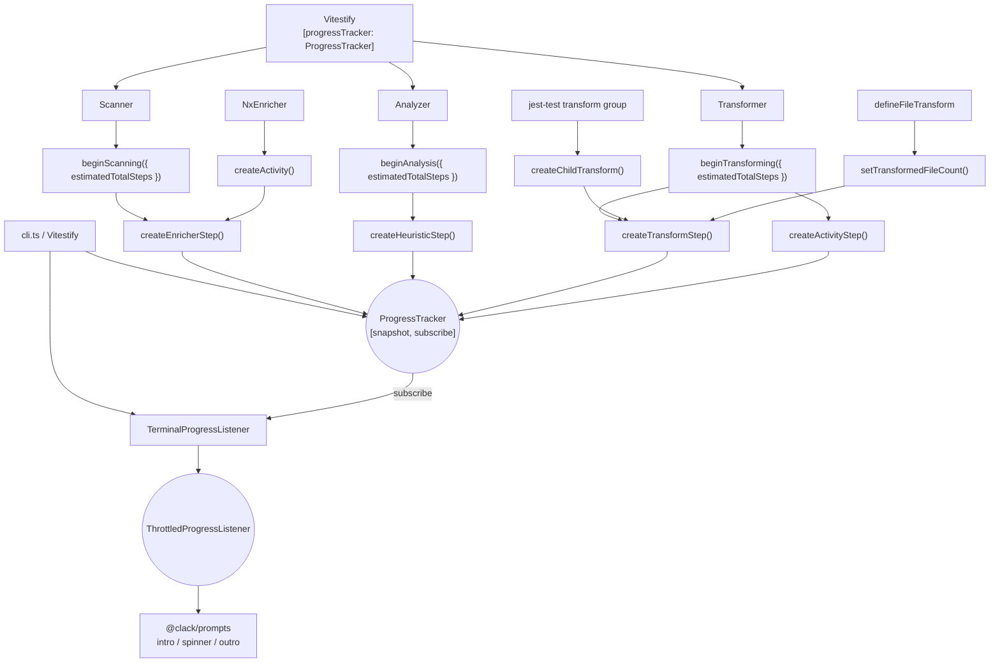

# Goals

- Nested transform groups (e.g. `jest-test` with 10 child transforms per file) bury per-file progress in ephemeral spinner sub-steps.
- Maintainers cannot easily answer "which files were transformed, by which child transform, and with what outcome?" after or during a run.
- Make nested transform progress first-class: track child transforms and affected files as structured state, not only as formatted spinner lines.

# Non-Goals

- CI-specific progress output (GitHub Actions annotations, etc.) — defer; design should allow future reporter sinks, but no CI reporter in this work.
- Persisting progress to disk — in-run state only; no snapshot file or progress log written after the run.
- Replacing or subsumming `DEBUG=vitestify:*` — debug logging stays a separate diagnostic channel.
- Changing enricher scan behavior or merging scan passes — progress refactor only.
- Per-file terminal detail for every transform — terminal reporter may still summarize; full per-file detail lives in progress state, not necessarily on screen.

# Desired Behavior

## Progress state (authoritative)

- [ ] A `ProgressTracker` holds the full run state: phases → typed steps, with status (`started` | `done` | `failed`).
- [ ] Pipeline stages (`Scanner`, `Analyzer`, `Transformer`) mutate progress state — they do not write to the terminal directly.
- [ ] Progress state includes an **analyze** phase with one `heuristic` step per heuristic.
- [ ] Progress state includes a **transform** phase with top-level `transform` steps (e.g. `jest-test`, `vitest-config`).
- [ ] Every phase snapshot exposes `estimatedTotalSteps` (via `PhaseSnapshotBase`) and a `steps` array.
- [ ] Transform groups (e.g. `jest-test`) record **child `transform` steps** nested under the parent transform step.
- [ ] Child transforms can update the number of transformed files.
- [ ] Progress state exposes roll-up counts (e.g. files transformed per child transform, per parent transform).
- [ ] Observers can read the current snapshot at any time and subscribe to changes during the run.
- [ ] When stdout is not a TTY, progress state is still collected; only terminal output is suppressed.

## Terminal reporting (one sink)

- [ ] A `TerminalProgressReporter` subscribes to progress state changes and renders via `@clack/prompts` — same general UX as today.
- [ ] Terminal shows phase intro/outro, numbered steps, spinners, and sub-step lines for live feedback.
- [ ] Terminal may summarize nested transform detail (top-level spinner + sub-steps) rather than listing every file on screen.
- [ ] Throttling applies at the reporting layer (listener), not inside progress state or pipeline code.

## Nested `jest-test` transform group (primary motivating scenario)

- [ ] While `jest-test` runs, progress state records each child transform as a nested `transform` step under `jest-test`.
- [ ] Each child transform updates `transformedFileCount` on its `TransformStepSnapshot`.
- [ ] After the run, state answers: how many files were transformed by each child transform.

## Unchanged user-visible CLI flow

- [ ] `vitestify` on a TTY still shows scan → analyze → transform → finalize progression with spinners.
- [ ] Scan enrichers report `filesDetected` count; non-scan work (e.g. nx graph loading) uses nested `activity` steps — not free-form strings on the enricher.
- [ ] Transform verify/rollback and apply-changes substeps still appear in terminal output.
- [ ] Non-TTY runs stay silent on the terminal (same as today).

# Design

Split progress into two layers:

1. **`ProgressTracker`** — authoritative in-memory state + mutation API (`createPhase` / `createStep` / …). Pipeline code writes here only.
2. **`ProgressListener`** — subscribes to tracker changes and renders to a sink (terminal today; logs/CI later).

The existing `Phase` / `Step` handle pattern stays, but handles are **typed by phase and step kind** — thin facades over `ProgressTracker` nodes that update state and emit change events; they do not render.

`ProgressReporterFake` is replaced by `ProgressTracker` (state + snapshot API). `TerminalProgressReporter` becomes a `ProgressListener` that maps snapshots to clack output.

## Data model

Snapshots use **discriminated unions** at both phase and step levels. Each type carries only fields relevant to that kind of work.

```typescript
type ProgressStatus = 'started' | 'done' | 'failed';

interface SnapshotBase {
  readonly status: ProgressStatus;
}

interface ProgressSnapshot {
  readonly phases: readonly PhaseSnapshot[];
}

type PhaseSnapshot =
  | ScanningPhaseSnapshot
  | AnalysisPhaseSnapshot
  | TransformingPhaseSnapshot;

interface PhaseSnapshotBase extends SnapshotBase {
  readonly estimatedTotalSteps: number;
}

/** Scanner phase — `steps` contains enricher steps only. */
interface ScanningPhaseSnapshot extends PhaseSnapshotBase {
  readonly kind: 'scanning';
  readonly steps: readonly EnricherStepSnapshot[];
}

/** Analyzer phase — `steps` contains heuristic steps only. */
interface AnalysisPhaseSnapshot extends PhaseSnapshotBase {
  readonly kind: 'analysis';
  readonly steps: readonly HeuristicStepSnapshot[];
}

type TransformingStepSnapshot = TransformStepSnapshot | ActivityStepSnapshot;

/** Transformer phase — `steps` contains transform and activity steps in pipeline order. */
interface TransformingPhaseSnapshot extends PhaseSnapshotBase {
  readonly kind: 'transforming';
  readonly steps: readonly TransformingStepSnapshot[];
}

interface StepSnapshotBase extends SnapshotBase {
  readonly stepNumber?: number;
  readonly stepCount?: number;
}

/** Scanner — one per enricher (code, jest, nx, …). */
interface EnricherStepSnapshot extends StepSnapshotBase {
  readonly kind: 'enricher';
  readonly name: string;
  readonly filesDetected?: number;
  readonly activities: readonly ActivityStepSnapshot[];
}

/** Free-form progress — loading nx graph, running a shell command, etc. */
interface ActivityStepSnapshot extends SnapshotBase {
  readonly kind: 'activity';
  readonly message: string;
}

/** Analyzer — one per heuristic. */
interface HeuristicStepSnapshot extends StepSnapshotBase {
  readonly kind: 'heuristic';
  readonly name: string;
  readonly message?: string;
}

/** Transformer — top-level and nested transforms (jest-test → jest-mock, …). */
interface TransformStepSnapshot extends StepSnapshotBase {
  readonly kind: 'transform';
  readonly name: string;
  readonly message?: string;
  readonly transformedFileCount?: number;
  readonly childTransforms: readonly TransformStepSnapshot[];
}
```

- **Every phase has `steps`** — unified property name; element type depends on phase `kind`.
- **`PhaseSnapshotBase`** — shared phase fields: `status` (from `SnapshotBase`) and `estimatedTotalSteps`.
- **`estimatedTotalSteps`** — set when the phase starts; primary loop size (`enrichers.length`, `heuristics.length`, `transforms.length`). Activity steps during transform are extra and may exceed this.
- **Phase `kind` discriminant** — narrows `steps` to the valid step type(s) for that phase.
- **Step `kind` discriminant** — within transforming phase, branch `steps` items on `transform` vs `activity`.
- **`ScanningPhaseSnapshot.steps`** — `EnricherStepSnapshot[]`.
- **`AnalysisPhaseSnapshot.steps`** — `HeuristicStepSnapshot[]`.
- **`TransformingPhaseSnapshot.steps`** — `(TransformStepSnapshot | ActivityStepSnapshot)[]` in pipeline order.
- **`EnricherStepSnapshot.filesDetected`** — numeric file count for scanning enrichers; terminal formats as `scanning · {n} file(s)`.
- **`EnricherStepSnapshot.activities`** — nested `activity` steps for non-count work during an enricher (e.g. `loading nx graph`).
- **`ActivityStepSnapshot`** — generic step with only `message`; used for nx graph loading, apply-changes commands, and other free-form status.
- **`TransformStepSnapshot.childTransforms`** — only transform steps nest (jest-test group).

## Mutation port (pipeline-facing)

Replace generic `createPhase` / `createStep` with **typed phase and step factories**. Each phase handle exposes only the step factories valid for its kind:

```typescript
export interface ProgressTracker {
  beginScanning(args: { estimatedTotalSteps: number }): ScanningPhase;
  beginAnalysis(args: { estimatedTotalSteps: number }): AnalysisPhase;
  beginTransforming(args: { estimatedTotalSteps: number }): TransformingPhase;
  snapshot(): ProgressSnapshot;
  subscribe(listener: (snapshot: ProgressSnapshot) => void): Unsubscribe;
}

export interface ScanningPhase {
  createEnricherStep(args: NumberedStepArgs & { name: string }): EnricherStep;
  done(): void;
}

export interface AnalysisPhase {
  createHeuristicStep(args: NumberedStepArgs & { name: string }): HeuristicStep;
  done(): void;
}

export interface TransformingPhase {
  createTransformStep(args: NumberedStepArgs & { name: string }): TransformStep;
  createActivityStep(): ActivityStep;
  done(): void;
}

export interface EnricherStep {
  setFilesDetected(count: number): void;
  createActivity(): ActivityStep;
  done(): void;
  error(message: string): void;
}

export interface ActivityStep {
  updateMessage(message: string): void;
  done(message?: string): void;
  error(message: string): void;
}

export interface HeuristicStep {
  updateMessage(message: string): void;
  done(message: string): void;
  error(message: string): void;
}

export interface TransformStep {
  updateMessage(message: string): void;
  setTransformedFileCount(count: number): void;
  createChildTransform(
    args: NumberedStepArgs & { name: string },
  ): TransformStep;
  done(message: string): void;
  error(message: string): void;
}

type NumberedStepArgs = { stepNumber: number; stepCount: number };
```

Pipeline stages call the phase and step factory matching their work:

| Stage                       | Phase factory                                         | Step factory          |
| --------------------------- | ----------------------------------------------------- | --------------------- |
| `Scanner`                   | `beginScanning({ estimatedTotalSteps: enrichers.length })` | `createEnricherStep`  |
| `Analyzer`                  | `beginAnalysis({ estimatedTotalSteps: heuristics.length })` | `createHeuristicStep` |
| `Transformer`               | `beginTransforming({ estimatedTotalSteps: transforms.length })` | `createTransformStep` |
| `Transformer._applyChanges` | (same `TransformingPhase`)                            | `createActivityStep`  |

`PipelineContext.progressStep` becomes `TransformStep` (transforms only receive transform handles).

`NullProgressTracker` no-ops all mutations (replaces `NullProgressReporter`). Tests inject `ProgressTracker` and assert via `snapshot()`, filtering steps by `kind`.

## Listener port (sink-facing)

```typescript
export interface ProgressListener {
  attach(tracker: ProgressTracker): Unsubscribe;
}
```

- `TerminalProgressListener` — maps snapshot diffs to `@clack/prompts` intro/outro, spinners, sub-step lines. No-ops when `!process.stdout.isTTY`.
- `ThrottledProgressListener` — decorates any listener; throttles re-renders on `updateMessage` / `setTransformedFileCount` (moves throttling out of the tracker).

CLI wiring:

```typescript
const tracker = new ProgressTracker();
const terminal = new ThrottledProgressListener(new TerminalProgressListener());
terminal.attach(tracker);

new Vitestify({ progressTracker: tracker });
```

## Nested transform reporting

**`jest-test` transform group** — create a child `TransformStep` per entry in `JEST_TEST_TRANSFORMS`:

```typescript
const childStep = progressStep.createChildTransform({
  name: transform.name,
  stepNumber: index + 1,
  stepCount: total,
});
await transform.apply({ ...options, progressStep: childStep });
```

**`defineFileTransform`** — report structured count on the `TransformStep`:

```typescript
progressStep.setTransformedFileCount(transformedCount);
progressStep.done(`${transformedCount} file(s) transformed`);
```

**`Scanner` / file-scanning enrichers** — report numeric file count:

```typescript
progressStep.setFilesDetected(files.length);
```

**`NxEnricher`** — non-count work via nested activity under the enricher step:

```typescript
const activity = progressStep.createActivity();
activity.updateMessage('loading nx graph');
const graph = await _runNxGraphCommand(options);
progressStep.setFilesDetected(projects.length);
activity.done();
```

**`Transformer._applyChanges`** — each drained command is an activity step:

```typescript
const activity = phase.createActivityStep();
activity.updateMessage(`${command.join(' ')} · running`);
await commandRunner.run(command);
activity.done(`${command.join(' ')} · succeeded`);
```

Terminal listener formats each `kind` for display (e.g. enricher → `scanning · 142 file(s)`, activity → message as-is, transform child → `[2/10] jest-mock · 5 file(s) transformed`). State holds typed fields; formatting lives in the listener.

## Diagram



## Implementation Details

- [ ] Add `PhaseSnapshotBase extends SnapshotBase` with `estimatedTotalSteps`; all phase snapshots extend it.
- [ ] Add typed `PhaseSnapshot` discriminated union (`scanning` | `analysis` | `transforming`) and typed step snapshots.
- [ ] Add `ProgressTracker` with immutable snapshots; phase factories accept `{ estimatedTotalSteps }`.
- [ ] Add `subscribe(listener)` — emit full snapshot on every mutation; listeners diff/render as needed.
- [ ] Replace `ProgressReporter` with `ProgressTracker`; replace generic `Phase` / `Step` with typed handles per phase and step kind.
- [ ] Add typed step factories on each phase handle (see mutation port table).
- [ ] Add `TransformStep.createChildTransform()` and `TransformStep.setTransformedFileCount()`.
- [ ] Replace `NullProgressReporter` with `NullProgressTracker`; replace `ProgressReporterFake` with `ProgressTracker` + `snapshot()` assertions filtered by `kind`.
- [ ] Add `ProgressListener` interface with `attach(tracker)`.
- [ ] Refactor `TerminalProgressReporter` → `TerminalProgressListener` — format each step `kind` for clack output.
- [ ] Refactor `ThrottledProgressReporter` → `ThrottledProgressListener` — throttle listener re-renders, not tracker mutations.
- [ ] Update `Vitestify` constructor: accept `progressTracker`; wire terminal listener in CLI entry point.
- [ ] Update `Scanner`: `beginScanning()` + `createEnricherStep` + `setFilesDetected`.
- [ ] Update enrichers: file scanners call `setFilesDetected`; `NxEnricher` uses `createActivity()` for graph loading.
- [ ] Update `Analyzer`: `beginAnalysis()` + `createHeuristicStep`.
- [ ] Update `Transformer`: `beginTransforming()` + `createTransformStep` / `createActivityStep` for apply-changes commands.
- [ ] Update `TransformOptions.progressStep` type to `TransformStep`.
- [ ] Update `jest-test` transform: `createChildTransform` per child transform.
- [ ] Update `defineFileTransform`: call `setTransformedFileCount` during and after the file loop.
- [ ] Remove `ProgressReporterFake` and generic `SubStep` API once typed steps cover all cases.

# Testing Strategy

# PR Plan

# Alternatives Considered

# Kitchen Sink
