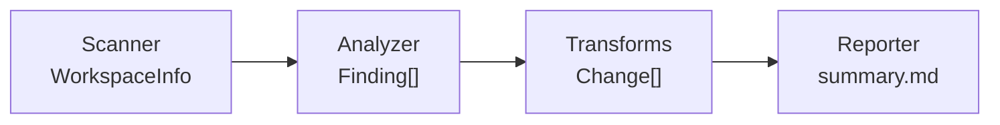
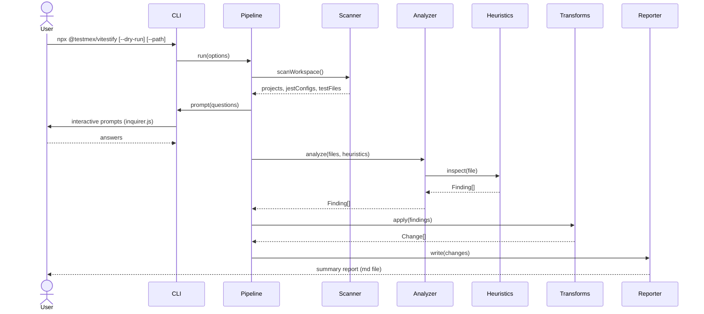
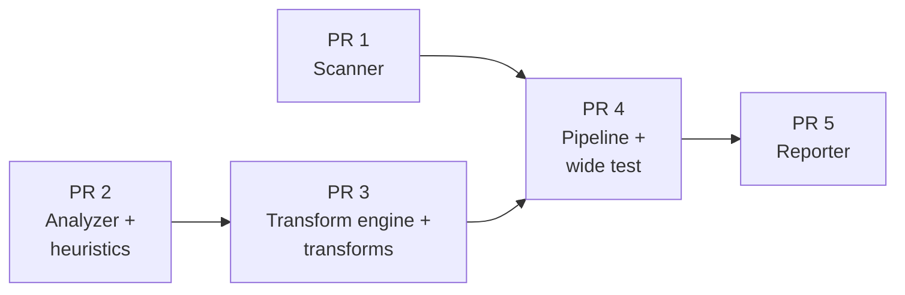

# Goals

- Provide a single command that migrates an Angular project (CLI or Nx) from Jest to Vitest.
- Make the architecture framework-agnostic so it can support other frameworks (e.g. React, Vue) in the future.
- Make it easy to add new heuristics and transforms without touching core orchestration logic.
- For migrations that are too complex to automate reliably, generate agent instructions that an AI coding assistant can follow to complete the migration.

# Non-Goals

- **Runtime test helpers** — this tool only migrates config and files; it does not ship utilities used at test runtime.
- **Full Jest API compatibility layer** — we transform common patterns but do not polyfill Jest APIs that have no Vitest equivalent.
- **Non-Angular frameworks in v1** — the architecture supports them, but v1 only ships Angular heuristics.
- **Migrating from other test runners** (Karma, Jasmine) — Jest-to-Vitest only for now.
- **Automatic fix of all edge cases** — the tool handles common patterns; exotic setups may need manual follow-up (covered by agent instructions where possible).

# Desired Behavior

- User runs `npx @testmex/vitestify` from the workspace root.
- The command scans the workspace, detecting Angular CLI / Nx projects, Jest config files, and test files.
- If ambiguity or choices arise (e.g. multiple projects, unclear config), the tool prompts the user interactively.
- The tool applies transforms: updates config files, rewrites Jest-specific imports/APIs in test files, updates `package.json` dependencies, etc.
- Progress is logged to stdout as each step completes.
- At the end, a Markdown summary report is written to disk listing all changes made.
- For migrations too complex to automate, agent instruction files are written alongside the report.
- `--dry-run` — scans and reports what would change without writing anything.
- `--path <dir>` — target a specific project or subdirectory instead of the full workspace.

# Design

1. **CLI** — entry point. Parses `--dry-run` and `--path` flags. Uses **inquirer.js** for interactive prompts. Bootstraps the pipeline.
2. **Scanner** — discovers workspace structure: project type (Angular CLI vs Nx), Jest config files, test files, `package.json` entries.
3. **Analyzer** — the engine. Iterates over all discovered files, applies each registered **Heuristic**, and collects findings.
4. **Heuristics** — small, composable rules registered in a simple array. Each heuristic inspects a file (or config) and produces **Findings** (e.g. "file uses `jest.mock`", "jest.config has `moduleNameMapper`"). Easy to add new ones.
5. **Transforms** — each transform receives a list of findings and returns a list of changes (file rewrites, new files, or agent-instruction Markdown). Registered in a simple array — including the agent-instruction transform for unhandled findings.
6. **Reporter** — collects all changes and writes a Markdown summary report.
7. **Pipeline** — wires it all together: CLI → Scanner → Analyzer → Transforms → Reporter. Respects `--dry-run`.

## Mental Model

**detect → act → report.** The scanner maps the workspace (`WorkspaceInfo`). Heuristics produce **findings** — observations about what needs changing. **Transforms** turn findings into **changes**: each change has a target path, new content, and optionally an original path (omitted for file creations). The agent-instruction transform is just another transform — it writes Markdown files for findings nothing else handled. The reporter summarizes all changes.



## Diagram



## Implementation Details

- **Heuristic & Transform registration**: hardcoded arrays — no auto-discovery or plugin system.
- **Code transforms**: use **jscodeshift** for AST-based rewrites of test files (e.g. `jest.mock` → `vi.mock`).
- **Config parsing**: only `jest.config.ts` is supported for now. Other formats (`jest.config.js`, `package.json` inline) are out of scope for v1.
- **Finding tags**: each `Finding` carries a `tags` property — a union of known tags (e.g. `"jest"`, `"testing-library"`) for grouping and reporting.

### Core

```typescript
type RelativePath = string & { readonly [__relativePathBrand]: true };
```

`RelativePath` is a branded string type that represents a path relative to the workspace root.

### Scanner

```typescript
class Scanner {
  constructor(args: { commandRunner: CommandRunner; fileSystem: FileSystem }) {}

  async scanWorkspace(): Promise<WorkspaceInfo> {}
}

interface Enricher {
  enrich(workspaceInfo: WorkspaceInfo): Promise<WorkspaceInfo>;
}

interface WorkspaceInfo {
  workspaceType: 'angular-cli' | 'nx' | null;
  projects: Project[];
}

interface Project {
  name: string;
  path: RelativePath;
  files: ProjectFile[];
}

interface ProjectFile {
  path: RelativePath;
  tags: ProjectFileTag[];
}

type ProjectFileTag = 'jest-config' | 'nx-project-json' | 'test' | 'tsconfig';
```

Each `Enricher` (e.g. `AngularCliEnricher`, `NxEnricher`) augments a partial `WorkspaceInfo` with projects and files discovered for its workspace type.

### Analyzer

```typescript
class Analyzer {
  async analyze(
    files: ProjectFile[],
    heuristics: Heuristic[],
    fileSystem: FileSystem
  ): Promise<Finding[]> {}
}
```

### Heuristics & Findings

```typescript
interface Heuristic {
  inspect(file: ProjectFile, content: string): Promise<Finding[]>;
}

interface Finding {
  type: FindingType;
  tags: FindingTag[];
  project: Project;
  file: ProjectFile;
  description: string;
}

type FindingType = 'jest-mock-call'; // extensible per heuristic

type FindingTag = 'jest' | 'testing-library';
```

`FindingType` identifies the specific pattern detected. `FindingTag` groups related findings for filtering and reporting.

### Transforms & Changes

```typescript
interface Transform {
  apply(findings: Finding[]): Promise<Change[]>;
}

interface Change {
  originalPath?: RelativePath;
  path: RelativePath;
  content: string;
}
```

`originalPath` is omitted for file creations. For in-place edits, `originalPath` and `path` are the same.

### Pipeline

```typescript
interface PipelineOptions {
  dryRun: boolean;
  path?: RelativePath;
}

interface PipelineResult {
  changes: Change[];
  unhandledFindings: Finding[];
}

class Pipeline {
  async run(options: PipelineOptions): Promise<PipelineResult> {}
}
```

### Reporter

```typescript
class Reporter {
  write(result: PipelineResult, outputPath: RelativePath): Promise<void> {}
}
```

# Testing Strategy

## Scanner

### Detects Angular CLI project:

- Arrange: create a temp workspace with `angular.json` and a `jest.config.ts`.
- Act: run scanner on the workspace path.
- Assert: returns project type `angular-cli` with the jest config path.

### Detects Nx project:

- Arrange: create a temp workspace with `nx.json`, `project.json`, and a `jest.config.ts`.
- Act: run scanner on the workspace path.
- Assert: returns project type `nx` with the jest config path.

## Analyzer

### Collects findings from heuristics:

- Arrange: create two dummy heuristics — one returns a finding, one returns nothing.
- Act: run analyzer with a fake file list.
- Assert: returns exactly the one finding.

## Heuristics

### Detects `jest.mock` usage:

- Arrange: provide a file containing `jest.mock('./foo')`.
- Act: run the heuristic.
- Assert: returns a finding of type `jest-mock-call` with tag `"jest"`.

## Transforms

### Rewrites `jest.mock` to `vi.mock`:

- Arrange: provide findings and source code with `jest.mock('./foo')`.
- Act: apply the transform.
- Assert: returns a change whose content contains `vi.mock('./foo')`.

### Agent instruction transform writes Markdown for unhandled findings:

- Arrange: provide findings no other transform handles.
- Act: apply the agent-instruction transform.
- Assert: returns a change with Markdown content and no `originalPath`.

## Pipeline

### Dry-run does not write files:

- Arrange: set up a workspace with a jest config and test files.
- Act: run the pipeline with `--dry-run`.
- Assert: no files are modified; report is still generated to stdout.

### Wide test — applies transforms and writes report:

- Arrange: set up a workspace with a jest config and a test file using `jest.mock`.
- Act: run the pipeline.
- Assert: test file is rewritten, report file exists on disk.

# PR Plan



1. **PR 1 — Scanner**: workspace detection (Angular CLI vs Nx), Jest config discovery, test file discovery. Introduces Scanner types and implementation. Tests included.
2. **PR 2 — Analyzer + heuristics**: analyzer engine, `Finding`/`Heuristic` types, tag system. Ships with all v1 heuristics. Tests included.
3. **PR 3 — Transform engine + transforms**: `Transform`/`Change` types, transform runner. Ships with all v1 transforms (e.g. `jest.mock` → `vi.mock` via jscodeshift, agent-instruction transform). Tests included.
4. **PR 4 — Pipeline + wide test**: CLI entry point with `--dry-run`, `--path`, inquirer.js prompts. Wires Scanner + Analyzer + Transforms. Wide integration test.
5. **PR 5 — Reporter**: writes the Markdown summary report. Plugs into the pipeline. Tests included.

# Alternatives Considered

- **Nx generator instead of standalone CLI** — would tie the tool to `@nx/devkit`, which is often coupled to specific Nx versions, making it harder to support across different workspaces. A standalone CLI avoids this dependency and works with both Angular CLI and Nx projects.

# Kitchen Sink
