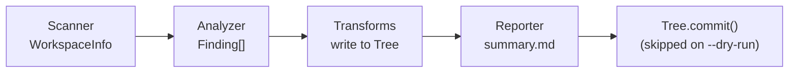
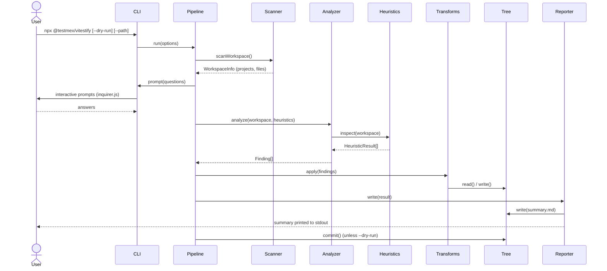
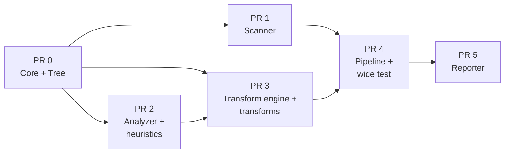

# Goals

- Provide a single command that migrates an Angular project (CLI or Nx) from Jest to Vitest.
- Make the architecture framework-agnostic so it can support other frameworks (e.g. React, Vue) in the future.
- Make it easy to add new heuristics and transforms without touching core orchestration logic.
- For migrations that are too complex to automate reliably, generate agent instructions that an AI coding assistant can follow to complete the migration.

# Non-Goals

- **Runtime test helpers** — this tool only migrates config and files; it does not ship utilities used at test runtime.
- **Full Jest API compatibility layer** — we transform common patterns but do not polyfill Jest APIs that have no Vitest equivalent.
- **Non-Angular frameworks in v1** — the architecture supports them, but v1 only ships Angular heuristics.
- **Migrating from other test runners** (Karma, Jasmine) — Jest-to-Vitest only for now.
- **Automatic fix of all edge cases** — the tool handles common patterns; exotic setups may need manual follow-up (covered by agent instructions where possible).

# Desired Behavior

- User runs `npx @testmex/vitestify` from the workspace root.
- The command scans the workspace, detecting Angular CLI / Nx projects, Jest config files, and test files.
- If ambiguity or choices arise (e.g. multiple projects, unclear config), the tool prompts the user interactively.
- The tool applies transforms: updates config files, rewrites Jest-specific imports/APIs in test files, updates `package.json` dependencies, etc.
- Progress is logged to stdout as each step completes.
- At the end, a Markdown summary report is written to disk listing all changes made.
- For migrations too complex to automate, agent instruction files are written alongside the report.
- `--dry-run` — scans and reports what would change without writing anything.
- `--path <dir>` — target a specific project or subdirectory instead of the full workspace.

# Design

1. **CLI** — entry point. Parses `--dry-run` and `--path` flags. Uses **inquirer.js** for interactive prompts. Bootstraps the pipeline.
2. **Scanner** — discovers workspace structure: project type (Angular CLI vs Nx), Jest config files, test files, `package.json` entries.
3. **Analyzer** — the engine. Runs registered heuristics over the `Workspace` and collects findings.
4. **Heuristics** — small, composable rules registered in a simple array.
   - Each **Heuristic** receives the full `Workspace` (`WorkspaceInfo` + `Tree`).
   - It can inspect individual files, cross-file relationships, or whole projects.
   - Examples: "file uses `jest.mock`", "per-project `jest.config.ts` extends the Nx `jest.preset.js`".
   - They produce **Findings**. Easy to add new ones.
5. **Transforms** — each transform is constructed with the shared `Tree`.
   - It receives a list of findings, reads source from the `Tree`, and writes edits back to it.
   - Registered in a simple array.
   - The agent-instruction transform is just another transform that handles findings flagged as needing manual help.
6. **Reporter** — summarizes all staged changes and writes a Markdown summary report.
7. **Pipeline** — wires it all together: CLI → Scanner → Analyzer → Transforms → Reporter, all sharing one `Tree`. Respects `--dry-run` by skipping the `Tree` commit.

## Mental Model

**detect → act → report.**

- The scanner maps the workspace (`WorkspaceInfo`).
- The pipeline bundles that with a shared `Tree` into a **`Workspace`**.
- Heuristics inspect the `Workspace` and produce **findings** — observations about what needs changing.
- Heuristics have full access to file content and cross-file context via the `Tree`.
- **Transforms** act on findings by reading and writing through the same `Tree`.
- The `Tree` is an in-memory overlay over the file system.
- It reads lazily, caches edits, and flushes them on `commit()`.
- Because all transforms edit the same `Tree`, several of them can touch the same file in sequence without clobbering each other.
- A **change** is the `Tree`'s record of a staged create, update (optionally with a rename), or delete.
- The agent-instruction transform is just another transform — it stages Markdown files for findings flagged as needing manual help.
- The reporter summarizes all staged changes.



## Diagram



## Implementation Details

- **Heuristic & Transform registration**: hardcoded arrays — no auto-discovery or plugin system. Heuristics and transforms are registered as simple arrays. Transforms are registered as factories that receive the shared `Tree`.
- **Tree**:
  - An in-memory overlay over the `FileSystem`.
  - Reads are lazy and cached.
  - Writes/deletes are staged in memory.
  - `commit()` flushes staged changes to disk.
  - It is the single channel through which the analyzer, transforms, and reporter touch file content.
  - This is what makes multi-transform edits to the same file compose.
- **Code transforms**: use **jscodeshift** for AST-based rewrites of test files (e.g. `jest.mock` → `vi.mock`).
- **Config parsing**:
  - Support the Jest config in all its common forms — `jest.config.{ts,js,mjs,cjs}`, the Nx `jest.preset.js`, and an inline `jest` field in `package.json`.
  - JS/TS configs are edited via AST.
  - The `package.json` field is edited via structured JSON edit.
  - Migrating from Karma/Jasmine configs remains out of scope.
- **Finding tags**:
  - Each `Finding` carries a `tags` property used for grouping and reporting.
  - The type allows known tags (e.g. `"jest"`, `"testing-library"`, `"needs-agent"`) for autocomplete while staying open to new tags.
  - Adding a heuristic never requires editing a central union.
- **Test runner wiring**:
  - Changing config files is not enough — the runner has to invoke Vitest.
  - A heuristic detects how tests are currently run.
  - A transform rewrites it.
  - For **Nx**: the `@nx/jest:jest` target in `project.json` is rewritten to a Vitest target (`@nx/vite:test`, or `@analogjs/vitest-angular:test` for Angular-in-Nx) with a generated `vite.config.ts`.
  - For **Angular CLI**: the `test` target's Jest builder in `angular.json` is rewritten to the Vitest builder.
  - Cases too gnarly to rewrite safely emit a `needs-agent` finding for the agent-instruction transform.

### Core

```typescript
type RelativePath = string & { readonly [__relativePathBrand]: true };
```

`RelativePath` is a branded string type. It represents a path relative to the workspace root.

```typescript
class Tree {
  constructor(args: { fileSystem: FileSystem }) {}

  exists(path: RelativePath): Promise<boolean> {}
  read(path: RelativePath): Promise<string> {} // lazy, cached
  write(path: RelativePath, content: string, options?: { originalPath?: RelativePath }): void {} // staged in memory; optional originalPath renames on commit
  delete(path: RelativePath): void {} // staged in memory
  changes(): Change[] {} // staged, uncommitted edits
  commit(): Promise<void> {} // flush staged changes to the FileSystem
}
```

The `Tree` is the shared mutation surface for the whole pipeline.

- The analyzer reads through it.
- Transforms read and write through it.
- The reporter stages its report file through it.
- Edits live in one in-memory cache until `commit()`.
- Multiple transforms can edit the same file in sequence and each sees the previous transform's output.
- `--dry-run` simply never calls `commit()`.

### Scanner

```typescript
class Scanner {
  constructor(args: {
    commandRunner: CommandRunner;
    fileSystem: FileSystem;
    enrichers: Enricher[];
  }) {}

  async scanWorkspace(): Promise<WorkspaceInfo> {}
}

interface Enricher {
  enrich(workspaceInfo: WorkspaceInfo): Promise<WorkspaceInfo>;
}

interface WorkspaceInfo {
  workspaceType: 'angular-cli' | 'nx' | null;
  projects: Project[];
}

interface Project {
  name: string;
  path: RelativePath;
  files: ProjectFile[];
}

interface ProjectFile {
  path: RelativePath;
  tags: ProjectFileTag[];
}

type ProjectFileTag =
  | 'jest-config' // jest.config.{ts,js,mjs,cjs} or package.json jest field
  | 'nx-project-json'
  | 'angular-json'
  | 'test'
  | 'tsconfig';
```

`scanWorkspace` workflow:

- First detects `workspaceType` (presence of `nx.json` → `nx`, else `angular.json` → `angular-cli`).
- Then runs each registered `Enricher` in order.
- Each `Enricher` (e.g. `AngularCliEnricher`, `NxEnricher`) checks whether it applies to the detected `workspaceType`.
- If so, it augments the `WorkspaceInfo` with the projects and files it discovers.
- Enrichers are passed into the `Scanner` constructor so the set is explicit and testable.

The pipeline assembles a `Workspace` from the scanner output and the shared `Tree`:

```typescript
type Workspace = { info: WorkspaceInfo; tree: Tree };
```

### Analyzer

```typescript
class Analyzer {
  async analyze(
    workspace: Workspace,
    heuristics: Heuristic[],
  ): Promise<Finding[]> {}
}
```

The analyzer runs every registered `Heuristic` against the `Workspace`.

- Each heuristic decides what to inspect — a single file, a whole project, or cross-file relationships.
- It uses `workspace.info` and `workspace.tree`.
- It returns `HeuristicResult`s stamped with the relevant `project` (and optional `file`).
- The analyzer collects them as `Finding`s.

### Heuristics & Findings

```typescript
interface Heuristic {
  inspect(workspace: Workspace): Promise<HeuristicResult[]>;
}

interface HeuristicResult {
  type: FindingType;
  tags: FindingTag[];
  description: string;
  project: Project; // the heuristic supplies the project context
  file?: ProjectFile; // when the finding relates to a specific file
}

interface Finding extends HeuristicResult {}

type FindingType = string; // e.g. 'jest-mock-call', 'nx-jest-executor' — defined per heuristic

type FindingTag = 'jest' | 'testing-library' | 'needs-agent' | (string & {});
```

Each heuristic receives the full `Workspace`.

- It can inspect individual files (via `workspace.tree.read`).
- It can inspect whole projects (via `workspace.info.projects`).
- It can inspect cross-file relationships — e.g. a per-project `jest.config.ts` that extends the Nx `jest.preset.js`, or imports that must be reconciled with `tsconfig` paths.
- Heuristics return `HeuristicResult`s stamped with the relevant `project` (and optional `file`).
- The analyzer passes them through as `Finding`s.
- `FindingType` identifies the specific pattern detected.
- `FindingTag` groups related findings for filtering and reporting.
- Tags are open so new heuristics never edit a central union.

### Transforms & Changes

```typescript
type TransformFactory = (args: { tree: Tree }) => Transform;

interface Transform {
  apply(findings: Finding[]): Promise<void>;
}

type CreateChange = { type: 'create'; path: RelativePath; content: string };
type DeleteChange = { type: 'delete'; path: RelativePath };
type UpdateChange = {
  type: 'update';
  path: RelativePath;
  content: string;
  originalPath?: RelativePath; // when set, commit renames originalPath → path
};

type Change = CreateChange | UpdateChange | DeleteChange;
```

Each transform is constructed with the shared `Tree` (via its `TransformFactory`).

- `apply` reads source through the `Tree` and writes edited content back to it.
- It returns nothing — there is no per-transform `Change[]` to merge.
- The `Tree` is the single accumulator of edits.
- A `jest.mock` rewrite and an import rewrite can both edit the same test file in sequence, each seeing the prior edit.
- `Change` is the `Tree`'s own derived record of what was staged:
  - `create` for new paths.
  - `delete` for removed paths.
  - `update` for in-place edits or renames (`path` is always the final path; pass `originalPath` to `Tree.write` when a transform renames a file, e.g. `jest.config.ts` → `vitest.config.ts`).

### Pipeline

```typescript
interface PipelineOptions {
  dryRun: boolean;
  path?: RelativePath;
}

interface PipelineResult {
  changes: Change[];
}

class Pipeline {
  async run(options: PipelineOptions): Promise<PipelineResult> {}
}
```

The pipeline workflow:

- Creates one `Tree` (over the real `FileSystem`).
- Assembles a `Workspace` from the scanner's `WorkspaceInfo` and that `Tree`.
- Threads both into the analyzer, transforms, and reporter.
- After transforms run, `result.changes` is `tree.changes()`.
- When `dryRun` is false it calls `tree.commit()` to flush everything to disk (including renames).
- When `dryRun` is true it skips the commit, so nothing is written.

### Reporter

```typescript
class Reporter {
  constructor(args: { tree: Tree }) {}

  write(result: PipelineResult, outputPath: RelativePath): Promise<void> {}
}
```

The reporter behavior:

- Always prints the summary to stdout.
- Stages `summary.md` into the `Tree`.
- Persisting it to disk happens through the pipeline's `tree.commit()`.
- Under `--dry-run` the summary is shown but never written.

# Testing Strategy

## Scanner

### [ ] Detects Angular CLI project:

- Arrange: create a temp workspace with `angular.json` and a `jest.config.ts`.
- Act: run scanner on the workspace path.
- Assert: returns project type `angular-cli` with the jest config path.

### [ ] Detects Nx project:

- Arrange: create a temp workspace with `nx.json`, `project.json`, and a `jest.config.ts`.
- Act: run scanner on the workspace path.
- Assert: returns project type `nx` with the jest config path.

## Analyzer

### [ ] Runs heuristics and passes through context:

- Arrange: a `Workspace` with one project and one file; one dummy `Heuristic` that returns a file-scoped result and one that returns a project-scoped result; one that returns nothing.
- Act: run analyzer.
- Assert: returns exactly two findings, each with `project` populated and the file-scoped finding's `file` populated.

## Heuristics

### [ ] Heuristic detects `jest.mock` usage:

- Arrange: a `Workspace` whose test file contains `jest.mock('./foo')`.
- Act: run the heuristic.
- Assert: returns a result of type `jest-mock-call` with tag `"jest"`.

### [ ] Heuristic detects config extending the Nx preset (cross-file):

- Arrange: a `Workspace` with a `jest.preset.js` and a per-project `jest.config.ts` that `require`s the preset.
- Act: run the heuristic.
- Assert: returns a result referencing both files (proving multi-file rules work).

## Transforms

### [ ] Rewrites `jest.mock` to `vi.mock` via the Tree:

- Arrange: a `Tree` whose test file contains `jest.mock('./foo')`; a matching finding.
- Act: construct the transform with the `Tree` and apply it.
- Assert: `tree.read(path)` now contains `vi.mock('./foo')`.

### [ ] Two transforms compose on the same file:

- Arrange: a `Tree` with a test file; findings for both a `jest.mock` rewrite and an import rewrite.
- Act: apply both transforms in sequence against the same `Tree`.
- Assert: the file reflects both edits (neither clobbers the other).

### [ ] Agent instruction transform stages Markdown for `needs-agent` findings:

- Arrange: a finding tagged `needs-agent`.
- Act: apply the agent-instruction transform.
- Assert: the `Tree` has a staged `create` change with Markdown content.

## Pipeline

### [ ] Dry-run does not write files:

- Arrange: set up a workspace with a jest config and test files.
- Act: run the pipeline with `--dry-run`.
- Assert: `tree.commit()` is never called and no files are modified; the summary is still printed to stdout and appears in `result.changes`.

### [ ] Wide test — applies transforms and commits report:

- Arrange: set up a workspace with a jest config and a test file using `jest.mock`.
- Act: run the pipeline.
- Assert: after commit, the test file is rewritten on disk and the report file exists on disk.

# PR Plan



1. [ ] **PR 0 — Core + Tree**:
   - `RelativePath`, `FileSystem`, and the `Tree` (lazy reads, in-memory staging, `changes()`, `commit()`).
   - Everything downstream depends on it.
   - Tests included.
2. [ ] **PR 1 — Scanner**:
   - Workspace detection (Angular CLI vs Nx).
   - `Enricher` interface + `AngularCliEnricher`/`NxEnricher`.
   - Jest config discovery (all forms), test file discovery.
   - Tests included.
3. [ ] **PR 2 — Analyzer + heuristics**:
   - Analyzer engine, `Workspace`/`Finding`/`HeuristicResult`/`Heuristic` types, tag system.
   - Ships with all v1 heuristics.
   - Tests included.
4. [ ] **PR 3 — Transform engine + transforms**:
   - `Transform`/`TransformFactory`/`Change` union (including rename-on-update), transform runner over the `Tree`.
   - Ships with all v1 transforms (e.g. `jest.mock` → `vi.mock` via jscodeshift, Nx/Angular runner-wiring transform, agent-instruction transform).
   - Tests included.
5. [ ] **PR 4 — Pipeline + wide test**:
   - CLI entry point with `--dry-run`, `--path`, inquirer.js prompts.
   - Wires Scanner + Analyzer + Transforms over one `Tree`.
   - Wide integration test.
6. [ ] **PR 5 — Reporter**:
   - Builds the Markdown summary, prints to stdout, stages it into the `Tree`.
   - Plugs into the pipeline.
   - Tests included.

# Alternatives Considered

- **Nx generator instead of standalone CLI**:
  - Would tie the tool to `@nx/devkit`.
  - `@nx/devkit` is often coupled to specific Nx versions.
  - That makes it harder to support across different workspaces.
  - A standalone CLI avoids this dependency.
  - It works with both Angular CLI and Nx projects.

# Kitchen Sink
