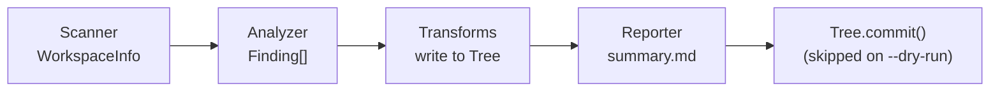
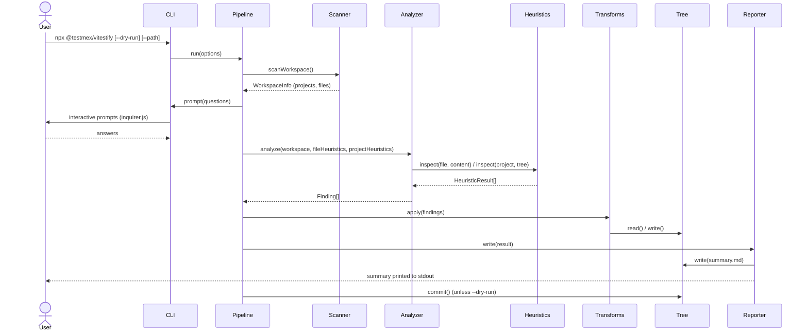
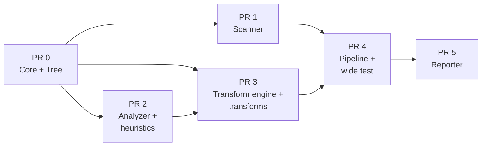

# Goals

- Provide a single command that migrates an Angular project (CLI or Nx) from Jest to Vitest.
- Make the architecture framework-agnostic so it can support other frameworks (e.g. React, Vue) in the future.
- Make it easy to add new heuristics and transforms without touching core orchestration logic.
- For migrations that are too complex to automate reliably, generate agent instructions that an AI coding assistant can follow to complete the migration.

# Non-Goals

- **Runtime test helpers** — this tool only migrates config and files; it does not ship utilities used at test runtime.
- **Full Jest API compatibility layer** — we transform common patterns but do not polyfill Jest APIs that have no Vitest equivalent.
- **Non-Angular frameworks in v1** — the architecture supports them, but v1 only ships Angular heuristics.
- **Migrating from other test runners** (Karma, Jasmine) — Jest-to-Vitest only for now.
- **Automatic fix of all edge cases** — the tool handles common patterns; exotic setups may need manual follow-up (covered by agent instructions where possible).

# Desired Behavior

- User runs `npx @testmex/vitestify` from the workspace root.
- The command scans the workspace, detecting Angular CLI / Nx projects, Jest config files, and test files.
- If ambiguity or choices arise (e.g. multiple projects, unclear config), the tool prompts the user interactively.
- The tool applies transforms: updates config files, rewrites Jest-specific imports/APIs in test files, updates `package.json` dependencies, etc.
- Progress is logged to stdout as each step completes.
- At the end, a Markdown summary report is written to disk listing all changes made.
- For migrations too complex to automate, agent instruction files are written alongside the report.
- `--dry-run` — scans and reports what would change without writing anything.
- `--path <dir>` — target a specific project or subdirectory instead of the full workspace.

# Design

1. **CLI** — entry point. Parses `--dry-run` and `--path` flags. Uses **inquirer.js** for interactive prompts. Bootstraps the pipeline.
2. **Scanner** — discovers workspace structure: project type (Angular CLI vs Nx), Jest config files, test files, `package.json` entries.
3. **Analyzer** — the engine. Runs two phases of registered heuristics and collects findings: per-file heuristics over each file, then project-level heuristics over each whole project.
4. **Heuristics** — small, composable rules registered in simple arrays. A **FileHeuristic** inspects one file and its content (e.g. "file uses `jest.mock`"). A **ProjectHeuristic** inspects a whole `Project` with `Tree` access, so it can reason across multiple files (e.g. "per-project `jest.config.ts` extends the Nx `jest.preset.js`", "`moduleNameMapper` references a `tsconfig` path"). Both produce **Findings**. Easy to add new ones.
5. **Transforms** — each transform is constructed with the shared `Tree`, receives a list of findings, reads source from the `Tree`, and writes edits back to it. Registered in a simple array. The agent-instruction transform is just another transform that handles findings flagged as needing manual help.
6. **Reporter** — summarizes all staged changes and writes a Markdown summary report.
7. **Pipeline** — wires it all together: CLI → Scanner → Analyzer → Transforms → Reporter, all sharing one `Tree`. Respects `--dry-run` by skipping the `Tree` commit.

## Mental Model

**detect → act → report.** The scanner maps the workspace (`WorkspaceInfo`). Heuristics produce **findings** — observations about what needs changing — in two phases: per-file and per-project (the latter can read across files via the `Tree`). **Transforms** act on findings by reading and writing through a shared **`Tree`** — an in-memory overlay over the file system that reads lazily, caches edits, and flushes them on `commit()`. Because all transforms edit the same `Tree`, several of them can touch the same file in sequence without clobbering each other. A **change** is the `Tree`'s record of a staged create/update/delete. The agent-instruction transform is just another transform — it stages Markdown files for findings flagged as needing manual help. The reporter summarizes all staged changes.



## Diagram



## Implementation Details

- **Heuristic & Transform registration**: hardcoded arrays — no auto-discovery or plugin system. There are two heuristic arrays (file-level and project-level). Transforms are registered as factories that receive the shared `Tree`.
- **Tree**: an in-memory overlay over the `FileSystem`. Reads are lazy and cached; writes/deletes are staged in memory; `commit()` flushes staged changes to disk. It is the single channel through which the analyzer, transforms, and reporter touch file content, which is what makes multi-transform edits to the same file compose.
- **Code transforms**: use **jscodeshift** for AST-based rewrites of test files (e.g. `jest.mock` → `vi.mock`).
- **Config parsing**: support the Jest config in all its common forms — `jest.config.{ts,js,mjs,cjs}`, the Nx `jest.preset.js`, and an inline `jest` field in `package.json`. JS/TS configs are edited via AST; the `package.json` field via structured JSON edit. (Migrating from Karma/Jasmine configs remains out of scope.)
- **Finding tags**: each `Finding` carries a `tags` property used for grouping and reporting. The type allows known tags (e.g. `"jest"`, `"testing-library"`, `"needs-agent"`) for autocomplete while staying open to new tags, so adding a heuristic never requires editing a central union.
- **Test runner wiring**: changing config files is not enough — the runner has to invoke Vitest. A `ProjectHeuristic` detects how tests are currently run and a transform rewrites it: for **Nx**, the `@nx/jest:jest` target in `project.json` is rewritten to a Vitest target (`@nx/vite:test`, or `@analogjs/vitest-angular:test` for Angular-in-Nx) with a generated `vite.config.ts`; for **Angular CLI**, the `test` target's Jest builder in `angular.json` is rewritten to the Vitest builder. Cases too gnarly to rewrite safely emit a `needs-agent` finding for the agent-instruction transform.

### Core

```typescript
type RelativePath = string & { readonly [__relativePathBrand]: true };
```

`RelativePath` is a branded string type that represents a path relative to the workspace root.

```typescript
class Tree {
  constructor(args: { fileSystem: FileSystem }) {}

  exists(path: RelativePath): Promise<boolean> {}
  read(path: RelativePath): Promise<string> {} // lazy, cached
  write(path: RelativePath, content: string): void {} // staged in memory
  delete(path: RelativePath): void {} // staged in memory
  changes(): Change[] {} // staged, uncommitted edits
  commit(): Promise<void> {} // flush staged changes to the FileSystem
}
```

The `Tree` is the shared mutation surface for the whole pipeline. The analyzer reads through it, transforms read and write through it, and the reporter stages its report file through it. Because edits live in one in-memory cache until `commit()`, multiple transforms can edit the same file in sequence and each sees the previous transform's output. `--dry-run` simply never calls `commit()`.

### Scanner

```typescript
class Scanner {
  constructor(args: {
    commandRunner: CommandRunner;
    fileSystem: FileSystem;
    enrichers: Enricher[];
  }) {}

  async scanWorkspace(): Promise<WorkspaceInfo> {}
}

interface Enricher {
  enrich(workspaceInfo: WorkspaceInfo): Promise<WorkspaceInfo>;
}

interface WorkspaceInfo {
  workspaceType: 'angular-cli' | 'nx' | null;
  projects: Project[];
}

interface Project {
  name: string;
  path: RelativePath;
  files: ProjectFile[];
}

interface ProjectFile {
  path: RelativePath;
  tags: ProjectFileTag[];
}

type ProjectFileTag =
  | 'jest-config' // jest.config.{ts,js,mjs,cjs} or package.json jest field
  | 'jest-preset' // Nx jest.preset.js
  | 'nx-project-json'
  | 'angular-json'
  | 'test'
  | 'tsconfig';
```

`scanWorkspace` first detects `workspaceType` (presence of `nx.json` → `nx`, else `angular.json` → `angular-cli`), then runs each registered `Enricher` in order. Each `Enricher` (e.g. `AngularCliEnricher`, `NxEnricher`) checks whether it applies to the detected `workspaceType` and, if so, augments the `WorkspaceInfo` with the projects and files it discovers. Enrichers are passed into the `Scanner` constructor so the set is explicit and testable.

### Analyzer

```typescript
class Analyzer {
  constructor(args: { tree: Tree }) {}

  async analyze(
    workspace: WorkspaceInfo,
    fileHeuristics: FileHeuristic[],
    projectHeuristics: ProjectHeuristic[]
  ): Promise<Finding[]> {}
}
```

For each project, the analyzer reads each file's content via the `Tree` and runs every `FileHeuristic`, then runs every `ProjectHeuristic` against the whole project (with `Tree` access for cross-file reads). It stamps each `HeuristicResult` with its owning `project` (and, for file heuristics, the `file`) to produce a `Finding`. This is what populates `Finding.project` — heuristics never have to supply it.

### Heuristics & Findings

```typescript
interface FileHeuristic {
  inspect(file: ProjectFile, content: string): Promise<HeuristicResult[]>;
}

interface ProjectHeuristic {
  inspect(project: Project, tree: Tree): Promise<HeuristicResult[]>;
}

interface HeuristicResult {
  type: FindingType;
  tags: FindingTag[];
  description: string;
  file?: ProjectFile; // a project heuristic may attach the file it relates to
}

interface Finding extends HeuristicResult {
  project: Project; // injected by the analyzer
  file?: ProjectFile; // injected by the analyzer for file heuristics
}

type FindingType = string; // e.g. 'jest-mock-call', 'nx-jest-executor' — defined per heuristic

type FindingTag = 'jest' | 'testing-library' | 'needs-agent' | (string & {});
```

A `FileHeuristic` sees exactly one file and its content. A `ProjectHeuristic` sees the whole `Project` plus the `Tree`, so it can read sibling files — this is how cross-file rules are expressed (e.g. a per-project `jest.config.ts` that extends the Nx `jest.preset.js`, or imports that must be reconciled with `tsconfig` paths). Heuristics return lightweight `HeuristicResult`s; the analyzer enriches them with `project`/`file` to produce `Finding`s. `FindingType` identifies the specific pattern detected; `FindingTag` groups related findings for filtering and reporting and is open so new heuristics never edit a central union.

### Transforms & Changes

```typescript
type TransformFactory = (args: { tree: Tree }) => Transform;

interface Transform {
  apply(findings: Finding[]): Promise<void>;
}

interface Change {
  type: 'create' | 'update' | 'delete';
  path: RelativePath;
  content?: string; // omitted for deletes
}
```

Each transform is constructed with the shared `Tree` (via its `TransformFactory`). `apply` reads source through the `Tree`, writes edited content back to it, and returns nothing — there is no per-transform `Change[]` to merge. The `Tree` is the single accumulator of edits, so a `jest.mock` rewrite and an import rewrite can both edit the same test file in sequence, each seeing the prior edit. `Change` is the `Tree`'s own derived record of what was staged (its `type` is inferred from whether the path existed on disk).

### Pipeline

```typescript
interface PipelineOptions {
  dryRun: boolean;
  path?: RelativePath;
}

interface PipelineResult {
  changes: Change[];
}

class Pipeline {
  async run(options: PipelineOptions): Promise<PipelineResult> {}
}
```

The pipeline creates one `Tree` (over the real `FileSystem`) and threads it into the analyzer, transforms, and reporter. After transforms run, `result.changes` is `tree.changes()`. When `dryRun` is false it calls `tree.commit()` to flush everything to disk; when `dryRun` is true it skips the commit, so nothing is written.

### Reporter

```typescript
class Reporter {
  constructor(args: { tree: Tree }) {}

  write(result: PipelineResult, outputPath: RelativePath): Promise<void> {}
}
```

The reporter always prints the summary to stdout, and stages `summary.md` into the `Tree`. Persisting it to disk therefore happens through the pipeline's `tree.commit()`, so under `--dry-run` the summary is shown but never written.

# Testing Strategy

## Scanner

### [ ] Detects Angular CLI project:

- Arrange: create a temp workspace with `angular.json` and a `jest.config.ts`.
- Act: run scanner on the workspace path.
- Assert: returns project type `angular-cli` with the jest config path.

### [ ] Detects Nx project:

- Arrange: create a temp workspace with `nx.json`, `project.json`, and a `jest.config.ts`.
- Act: run scanner on the workspace path.
- Assert: returns project type `nx` with the jest config path.

## Analyzer

### [ ] Runs file and project heuristics and stamps context:

- Arrange: a workspace with one project and one file; one dummy `FileHeuristic` that returns a result and one that returns nothing; one dummy `ProjectHeuristic` that returns a result.
- Act: run analyzer with a backing `Tree`.
- Assert: returns exactly two findings, each with `project` populated and the file-heuristic finding's `file` populated.

## Heuristics

### [ ] File heuristic detects `jest.mock` usage:

- Arrange: provide a file containing `jest.mock('./foo')`.
- Act: run the heuristic.
- Assert: returns a result of type `jest-mock-call` with tag `"jest"`.

### [ ] Project heuristic detects config extending the Nx preset (cross-file):

- Arrange: a `Tree` with a `jest.preset.js` and a per-project `jest.config.ts` that `require`s the preset.
- Act: run the project heuristic against the project.
- Assert: returns a result referencing both files (proving multi-file rules work).

## Transforms

### [ ] Rewrites `jest.mock` to `vi.mock` via the Tree:

- Arrange: a `Tree` whose test file contains `jest.mock('./foo')`; a matching finding.
- Act: construct the transform with the `Tree` and apply it.
- Assert: `tree.read(path)` now contains `vi.mock('./foo')`.

### [ ] Two transforms compose on the same file:

- Arrange: a `Tree` with a test file; findings for both a `jest.mock` rewrite and an import rewrite.
- Act: apply both transforms in sequence against the same `Tree`.
- Assert: the file reflects both edits (neither clobbers the other).

### [ ] Agent instruction transform stages Markdown for `needs-agent` findings:

- Arrange: a finding tagged `needs-agent`.
- Act: apply the agent-instruction transform.
- Assert: the `Tree` has a staged `create` change with Markdown content.

## Pipeline

### [ ] Dry-run does not write files:

- Arrange: set up a workspace with a jest config and test files.
- Act: run the pipeline with `--dry-run`.
- Assert: `tree.commit()` is never called and no files are modified; the summary is still printed to stdout and appears in `result.changes`.

### [ ] Wide test — applies transforms and commits report:

- Arrange: set up a workspace with a jest config and a test file using `jest.mock`.
- Act: run the pipeline.
- Assert: after commit, the test file is rewritten on disk and the report file exists on disk.

# PR Plan



1. [ ] **PR 0 — Core + Tree**: `RelativePath`, `FileSystem`, and the `Tree` (lazy reads, in-memory staging, `changes()`, `commit()`). Everything downstream depends on it. Tests included.
2. [ ] **PR 1 — Scanner**: workspace detection (Angular CLI vs Nx), `Enricher` interface + `AngularCliEnricher`/`NxEnricher`, Jest config discovery (all forms), test file discovery. Tests included.
3. [ ] **PR 2 — Analyzer + heuristics**: analyzer engine, `Finding`/`HeuristicResult`/`FileHeuristic`/`ProjectHeuristic` types, tag system, two-phase run with context stamping. Ships with all v1 heuristics. Tests included.
4. [ ] **PR 3 — Transform engine + transforms**: `Transform`/`TransformFactory`/`Change` types, transform runner over the `Tree`. Ships with all v1 transforms (e.g. `jest.mock` → `vi.mock` via jscodeshift, Nx/Angular runner-wiring transform, agent-instruction transform). Tests included.
5. [ ] **PR 4 — Pipeline + wide test**: CLI entry point with `--dry-run`, `--path`, inquirer.js prompts. Wires Scanner + Analyzer + Transforms over one `Tree`. Wide integration test.
6. [ ] **PR 5 — Reporter**: builds the Markdown summary, prints to stdout, stages it into the `Tree`. Plugs into the pipeline. Tests included.

# Alternatives Considered

- **Nx generator instead of standalone CLI** — would tie the tool to `@nx/devkit`, which is often coupled to specific Nx versions, making it harder to support across different workspaces. A standalone CLI avoids this dependency and works with both Angular CLI and Nx projects.

# Kitchen Sink
