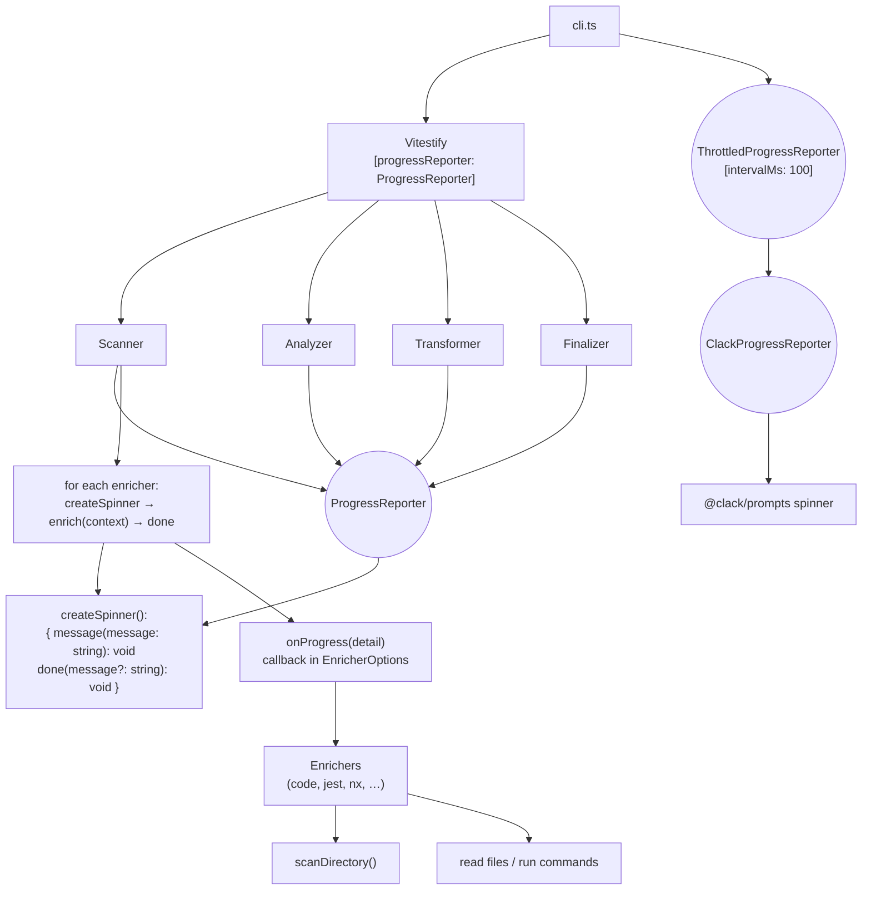
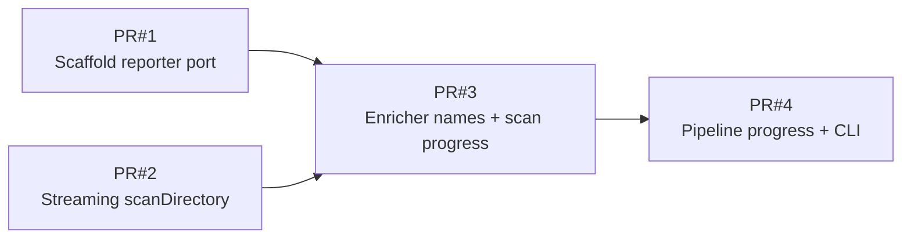

# Goals

- Give vitestify CLI users live feedback during long runs.
- Today the CLI is silent unless `DEBUG=vitestify:*` is set.
- Report progress across the full pipeline: scan → analyze → transform → finalize.
- Use `@clack/prompts` for TTY output (spinners and progress bars).
- Show progress automatically when stdout is a TTY.
- Keep domain/pipeline code decoupled from clack via a `ProgressReporter` port.

# Non-Goals

- Structured logging or log levels — keep `debug()` for diagnostics only.
- CI-specific progress output (GitHub Actions annotations, etc.).
- Per-file detail during analyze/transform — only phase-level and count-based feedback.
- Refactoring enrichers to share a single scan pass (separate concern).
- Progress when stdout is not a TTY (piped/redirected output stays silent).

# Desired Behavior

- [ ] When the user runs `vitestify` on a TTY, a spinner appears immediately.
- [ ] During scanning, one spinner per enricher shows the enricher name (e.g. "Scanning: code").
- [ ] Enrichers that scan files update the spinner with a live count (e.g. "Scanning: code… 142 files").
- [ ] Enrichers that do other work update with contextual detail (e.g. "Scanning: nx… loading nx graph").
- [ ] Enrichers that finish quickly may not call `onProgress` — spinner stays at the enricher name.
- [ ] Rapid scan updates are throttled by `ThrottledProgressReporter` (at most once every 100ms) — not in `Scanner` or enrichers.
- [ ] When each enricher completes, clack shows a green stop message (e.g. "Scanned: code").
- [ ] During analyze, a spinner shows the current heuristic name (e.g. "Analyzing: angular heuristic").
- [ ] When analyze completes, clack shows a green stop message with findings count.
- [ ] During transform, a spinner shows the current transform name.
- [ ] When transform completes, clack shows a green stop message.
- [ ] During finalize, a spinner shows the current command being run.
- [ ] When finalize completes, clack shows a green stop message.
- [ ] When stdout is not a TTY, no progress output is shown (existing silent behavior).
- [ ] `DEBUG=vitestify:*` continues to work alongside progress output.

# Design

- Add a `ProgressReporter` port with a minimal spinner API.
- `ClackProgressReporter` in infra wraps `@clack/prompts` spinner; no-ops when not a TTY.
- `ThrottledProgressReporter` decorates any `ProgressReporter` and throttles `message()` calls.
- CLI wires `ThrottledProgressReporter(ClackProgressReporter)` — pipeline stages stay unaware of throttling.
- Replace `FileSystem.scanDirectory()` return type with `AsyncIterable<RelativePath>` backed by `globbyStream`.
- Inject `ProgressReporter` into `Vitestify` and each pipeline stage.
- One spinner per work item (enricher, heuristic, transform, command) — not one global spinner.

## Scan progress: Scanner owns lifecycle, enrichers own detail

The Scanner orchestrates enrichers but does not discover files itself — each enricher does different work inside `enrich()`:

| Enricher | Work |
|---|---|
| `CodeEnricher`, `TestEnricher`, `VitestConfigEnricher` | Full `scanDirectory()` loop |
| `JestEnricher` | Three separate full scans + config parsing |
| `PackageManagerEnricher` | Reads 1–4 specific lock files |
| `AngularCliEnricher` | Reads `angular.json` |
| `NxEnricher` | Runs `nx graph --print` |

Only the enricher knows what it is doing. The Scanner cannot report file counts or status without enricher input.

**Scanner** creates a spinner per enricher, formats messages with the enricher name, and calls `done()` when `enrich()` returns.

**Enrichers** optionally push detail via a narrow `onProgress` callback — not `ProgressReporter` directly. This keeps pack/domain code decoupled from clack while letting each enricher report what makes sense for its work.

```typescript
export interface EnricherOptions {
  workspace: ReadonlyWorkspace;
  onProgress?(detail: string): void;
}

export interface Enricher {
  name: string;
  enrich(options: EnricherOptions): Promise<WorkspaceEnrichment>;
}
```

```typescript
// Scanner formats; enricher supplies detail
const spinner = this._progressReporter.createSpinner();
spinner.message(`Scanning: ${enricher.name}`);

await enricher.enrich({
  workspace: workspace.asReadonly(),
  onProgress: (detail) =>
    spinner.message(`Scanning: ${enricher.name}… ${detail}`),
});

spinner.done(`Scanned: ${enricher.name}`);
```

```typescript
// CodeEnricher — reports file count while scanning
async enrich({ workspace, onProgress }: EnricherOptions) {
  const files = [];
  for await (const path of workspace.tree.scanDirectory()) {
    files.push(path);
    onProgress?.(`${files.length} files`);
  }
}
```

```typescript
// NxEnricher — reports command status
async enrich({ workspace, onProgress }: EnricherOptions) {
  onProgress?.('loading nx graph');
  const graph = await this._runNxGraphCommand();
}
```

Add `name` to `Enricher` (like `Transform.name`) via a `defineEnricher({ name, enrich })` helper.

## Diagram



# PR Plan



# ✅ PR#1 — Scaffold ProgressReporter port and implementations

## Tasks

- [x] Add `ProgressReporter` interface with `createSpinner()` returning `{ message, done }`.
- [x] First `message()` call starts the clack spinner; subsequent calls update the message.
- [x] `done(message?)` stops the spinner with an optional final message.
- [x] Add `ProgressReporterFake` that records `message` and `done` calls for tests.
- [x] Add `ThrottledProgressReporter` decorator that wraps a `ProgressReporter` and throttles `message()` to a configurable interval (default 100ms).
- [x] `ThrottledProgressReporter` always flushes the latest pending message on `done()` — no stale count at phase end.
- [x] Add `ClackProgressReporter` in infra; no-op all methods when `!process.stdout.isTTY`.
- [x] Add `@clack/prompts` dependency to `@testmex/vitestify`.

## Testing Strategy

### ✅ ThrottledProgressReporter keeps pending message until interval elapses

- Wrap a `ProgressReporterFake` with `ThrottledProgressReporter({ intervalMs: 100 })`.
- Call `message('1/5')`, advance timers by 90ms, then call `message('2/5')`.
- Assert inner fake's last message is still `'1/5'`.

### ✅ ThrottledProgressReporter forwards pending message after interval elapses

- Wrap a `ProgressReporterFake` with `ThrottledProgressReporter({ intervalMs: 100 })`.
- Call `message('1/5')`, advance timers by 90ms, call `message('2/5')`, then advance timers by 10ms.
- Assert inner fake's last message is `'2/5'`.

### ✅ ThrottledProgressReporter flushes on done

- Wrap a `ProgressReporterFake` with `ThrottledProgressReporter({ intervalMs: 100 })`.
- Call `message('count: 99')` then immediately `done('count: 99')`.
- Assert inner fake's last message is `'count: 99'` and done message is `'count: 99'`.

# 🚧 PR#2 — Migrate FileSystem.scanDirectory to AsyncIterable

## Tasks

- [ ] Change `FileSystem.scanDirectory()` to return `AsyncIterable<RelativePath>`.
- [ ] Implement `FileSystemImpl.scanDirectory()` with `globbyStream` + `async function*`.
- [ ] Update `FileSystemCached`, `Tree`, `FileSystemFake` to match new signature.
- [ ] Update enrichers to collect paths: `for await (const path of workspace.tree.scanDirectory())`.

### 🚧 Existing scanner integration tests still pass

- Run existing `scanner.spec.ts` cases unchanged.
- Assert workspace detection behavior is identical to before migration.

# 🚧 PR#3 — Enricher names, context, and Scanner progress reporting

## Tasks

- [ ] Add `defineEnricher({ name, enrich })` helper; add `name` to `Enricher` interface.
- [x] Add `EnricherOptions` with `workspace` and optional `onProgress(detail: string)`.
- [x] Update `Enricher.enrich()` signature to accept `EnricherOptions`.
- [x] Give each enricher a `name` (e.g. `'code'`, `'test'`, `'jest'`, `'nx'`).
- [x] Inject `ProgressReporter` into `Vitestify` constructor (default: `NullProgressReporter`).
- [x] Pass reporter to `Scanner`.
- [x] Scanner: one spinner per enricher; create before `enrich()`, `done()` after.
- [x] Scanner: pass `{ onProgress }` callback that prefixes enricher name onto detail.
- [ ] File-scanning enrichers call `onProgress` with incrementing file counts.
- [ ] Non-scanning enrichers call `onProgress` with contextual status where useful (e.g. Nx: `'loading nx graph'`).

## Testing Strategy

### ✅ Scanner reports enricher name and file count from enricher callbacks

- Set up `Scanner` with `ProgressReporterFake`.
- Configure workspace with 5 files.
- Run `scanWorkspace()`.
- Assert messages contain enricher name (e.g. `'code'`) and incrementing file counts (`'1'`, `'2'`, … `'5'`).

### ✅ Scanner calls done once per enricher

- Set up `Scanner` with `ProgressReporterFake`.
- Run `scanWorkspace()` on a workspace with known enricher count.
- Assert `done` was called once per enricher (not only those that scan files).

### 🚧 Non-scanning enricher reports contextual status

- Set up `Scanner` with `ProgressReporterFake` and a workspace that triggers `NxEnricher`.
- Run `scanWorkspace()`.
- Assert messages contain `'nx'` and `'loading nx graph'`.

# 🚧 PR#4 — Analyzer, Transformer, Finalizer progress + CLI wiring

## Tasks

- [ ] Pass reporter to `Analyzer`, `Transformer`, `Finalizer`.
- [ ] Analyzer: one spinner per heuristic; `done` after each heuristic completes.
- [ ] Transformer: one spinner per transform; `done` after each transform completes.
- [ ] Finalizer: one spinner per command; `done` after each command completes.
- [ ] CLI wires `new ThrottledProgressReporter(new ClackProgressReporter())` into `Vitestify`.

## Testing Strategy

### 🚧 Analyzer reports heuristic name during inspect

- Set up `Analyzer` with `ProgressReporterFake` and 2 heuristics named `heuristic-a`, `heuristic-b`.
- Run `analyze()`.
- Assert messages contain `heuristic-a` and `heuristic-b`.
- Assert `done` called twice.

### 🚧 Transformer reports transform name during apply

- Set up `Transformer` with `ProgressReporterFake` and 2 transforms.
- Run `transform()`.
- Assert messages contain each transform name.
- Assert `done` called twice.

### 🚧 Finalizer reports command string during run

- Set up `Finalizer` with `ProgressReporterFake` and workspace with 2 queued commands.
- Run `finalize()`.
- Assert messages contain command strings.
- Assert `done` called twice.

### 🚧 CLI wires ThrottledProgressReporter around ClackProgressReporter

- Inspect `cli.ts` wiring (or integration test with mocked TTY).
- Assert `Vitestify` receives `ThrottledProgressReporter` wrapping `ClackProgressReporter`.

# Alternatives Considered

- **ora spinner** — already available transitively in the lockfile, but `@clack/prompts` is chosen for consistent CLI styling with future interactive prompts.
- **Throttle in Scanner** — rejected; throttling belongs in `ThrottledProgressReporter` so pipeline stages stay simple and the concern is reusable/testable.
- **Scanner reports file counts directly** — rejected; the Scanner orchestrates enrichers but does not discover files. Only enrichers know whether they are scanning, reading a config, or running a command.
- **Tree-level progress on `scanDirectory()`** — rejected; multiple enrichers scan independently (Jest scans three times), so tree-level counting would double/triple-count files and miss non-scan work.
- **Inject `ProgressReporter` into enrichers** — rejected; enrichers are pack/domain code and should stay decoupled from clack. A narrow `onProgress` callback keeps lifecycle (`createSpinner` / `done`) in the Scanner.
- **Structured progress events** (`{ kind: 'count' }` vs `{ kind: 'status' }`) — deferred; free-form `onProgress(detail: string)` is sufficient for v1. Scanner prefixes enricher name; enricher supplies detail.
