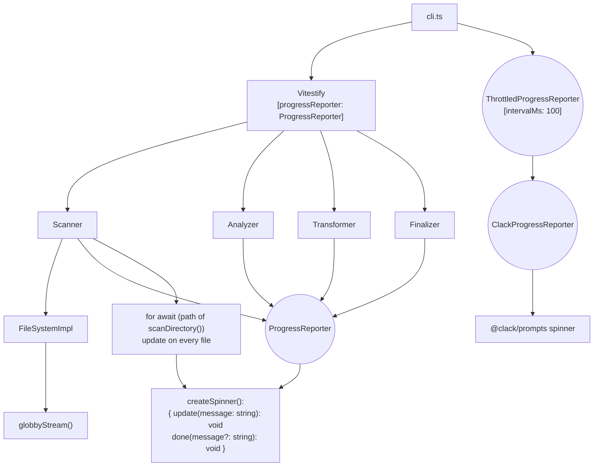
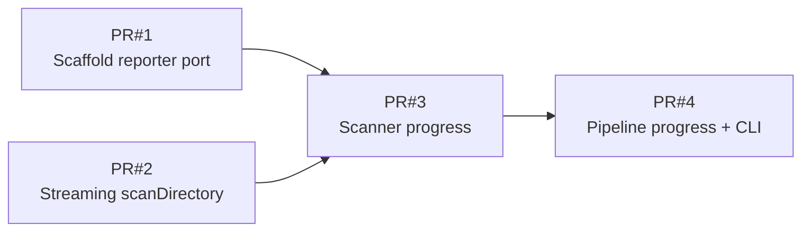

# Goals

- Give vitestify CLI users live feedback during long runs.
- Today the CLI is silent unless `DEBUG=vitestify:*` is set.
- Report progress across the full pipeline: scan → analyze → transform → finalize.
- Use `@clack/prompts` for TTY output (spinners and progress bars).
- Show progress automatically when stdout is a TTY.
- Keep domain/pipeline code decoupled from clack via a `ProgressReporter` port.

# Non-Goals

- Structured logging or log levels — keep `debug()` for diagnostics only.
- CI-specific progress output (GitHub Actions annotations, etc.).
- Per-file detail during analyze/transform — only phase-level and count-based feedback.
- Refactoring enrichers to share a single scan pass (separate concern).
- Progress when stdout is not a TTY (piped/redirected output stays silent).

# Desired Behavior

- [ ] When the user runs `vitestify` on a TTY, a spinner appears immediately.
- [ ] During scanning, the spinner message updates with a live file count (e.g. "Scanning files… 142 found").
- [ ] Rapid scan updates are throttled by `ThrottledProgressReporter` (at most once every 100ms) — not in `Scanner`.
- [ ] When scanning completes, clack shows a green stop message with the final file count.
- [ ] During analyze, a spinner shows the current heuristic name (e.g. "Analyzing: vitest-config heuristic").
- [ ] When analyze completes, clack shows a green stop message with findings count.
- [ ] During transform, a spinner shows the current transform name.
- [ ] When transform completes, clack shows a green stop message.
- [ ] During finalize, a spinner shows the current command being run.
- [ ] When finalize completes, clack shows a green stop message.
- [ ] When stdout is not a TTY, no progress output is shown (existing silent behavior).
- [ ] `DEBUG=vitestify:*` continues to work alongside progress output.

# Design

- Add a `ProgressReporter` port with a minimal spinner API.
- `ClackProgressReporter` in infra wraps `@clack/prompts` spinner; no-ops when not a TTY.
- `ThrottledProgressReporter` decorates any `ProgressReporter` and throttles `update()` calls.
- CLI wires `ThrottledProgressReporter(ClackProgressReporter)` — pipeline stages stay unaware of throttling.
- Replace `FileSystem.scanDirectory()` return type with `AsyncIterable<RelativePath>` backed by `globbyStream`.
- Inject `ProgressReporter` into `Vitestify` and each pipeline stage.
- One spinner per work item (enricher scan, heuristic, transform, command) — not one global spinner.

## Diagram

# PR Plan

# 🚧 PR#1 — Scaffold ProgressReporter port and implementations

## Tasks

- [ ] Add `ProgressReporter` interface with `createSpinner()` returning `{ update, done }`.
- [ ] First `update(message)` call starts the clack spinner; subsequent calls update the message.
- [ ] `done(message?)` stops the spinner with an optional final message.
- [ ] Add `ProgressReporterFake` that records `update` and `done` calls for tests.
- [ ] Add `ThrottledProgressReporter` decorator that wraps a `ProgressReporter` and throttles `update()` to a configurable interval (default 100ms).
- [ ] `ThrottledProgressReporter` always flushes the latest pending message on `done()` — no stale count at phase end.
- [ ] Add `ClackProgressReporter` in infra; no-op all methods when `!process.stdout.isTTY`.
- [ ] Add `@clack/prompts` dependency to `@testmex/vitestify`.

## Testing Strategy

### 🚧 ThrottledProgressReporter drops rapid updates

- Wrap a `ProgressReporterFake` with `ThrottledProgressReporter({ intervalMs: 100 })`.
- Call `update` 10 times within 50ms.
- Assert inner fake received fewer than 10 updates.

### 🚧 ThrottledProgressReporter flushes on done

- Wrap a `ProgressReporterFake` with `ThrottledProgressReporter({ intervalMs: 100 })`.
- Call `update('count: 99')` then immediately `done('count: 99')`.
- Assert inner fake's last update is `'count: 99'` and done message is `'count: 99'`.

# 🚧 PR#2 — Migrate FileSystem.scanDirectory to AsyncIterable

## Tasks

- [ ] Change `FileSystem.scanDirectory()` to return `AsyncIterable<RelativePath>`.
- [ ] Implement `FileSystemImpl.scanDirectory()` with `globbyStream` + `async function*`.
- [ ] Update `FileSystemCached`, `Tree`, `FileSystemFake` to match new signature.
- [ ] Update enrichers to collect paths: `for await (const path of workspace.tree.scanDirectory())`.

### 🚧 Existing scanner integration tests still pass

- Run existing `scanner.spec.ts` cases unchanged.
- Assert workspace detection behavior is identical to before migration.

# 🚧 PR#3 — Inject reporter into pipeline; Scanner progress reporting

## Tasks

- [ ] Inject `ProgressReporter` into `Vitestify` constructor (default: `NullProgressReporter`).
- [ ] Pass reporter to `Scanner`.
- [ ] Scanner: one spinner per enricher scan; call `update` on every discovered file (no throttle logic in Scanner).
- [ ] Scanner: `done` with final file count when each enricher scan completes.

## Testing Strategy

### 🚧 Scanner reports update per discovered file

- Set up `Scanner` with `ProgressReporterFake`.
- Configure workspace with 5 files.
- Run `scanWorkspace()`.
- Assert fake received at least 5 update calls containing incrementing file counts.

### 🚧 Scanner calls done after each enricher scan

- Set up `Scanner` with `ProgressReporterFake`.
- Run `scanWorkspace()` on a workspace with known enricher count.
- Assert `done` was called once per enricher that scans files.

# 🚧 PR#4 — Analyzer, Transformer, Finalizer progress + CLI wiring

## Tasks

- [ ] Pass reporter to `Analyzer`, `Transformer`, `Finalizer`.
- [ ] Analyzer: one spinner per heuristic; `done` after each heuristic completes.
- [ ] Transformer: one spinner per transform; `done` after each transform completes.
- [ ] Finalizer: one spinner per command; `done` after each command completes.
- [ ] CLI wires `new ThrottledProgressReporter(new ClackProgressReporter())` into `Vitestify`.

## Testing Strategy

### 🚧 Analyzer reports heuristic name during inspect

- Set up `Analyzer` with `ProgressReporterFake` and 2 heuristics named `heuristic-a`, `heuristic-b`.
- Run `analyze()`.
- Assert updates contain `heuristic-a` and `heuristic-b`.
- Assert `done` called twice.

### 🚧 Transformer reports transform name during apply

- Set up `Transformer` with `ProgressReporterFake` and 2 transforms.
- Run `transform()`.
- Assert updates contain each transform name.
- Assert `done` called twice.

### 🚧 Finalizer reports command string during run

- Set up `Finalizer` with `ProgressReporterFake` and workspace with 2 queued commands.
- Run `finalize()`.
- Assert updates contain command strings.
- Assert `done` called twice.

### 🚧 CLI wires ThrottledProgressReporter around ClackProgressReporter

- Inspect `cli.ts` wiring (or integration test with mocked TTY).
- Assert `Vitestify` receives `ThrottledProgressReporter` wrapping `ClackProgressReporter`.

# Alternatives Considered

- **ora spinner** — already available transitively in the lockfile, but `@clack/prompts` is chosen for consistent CLI styling with future interactive prompts.
- **Throttle in Scanner** — rejected; throttling belongs in `ThrottledProgressReporter` so pipeline stages stay simple and the concern is reusable/testable.

